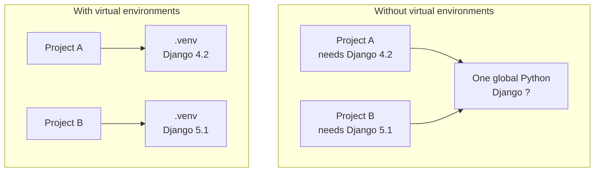
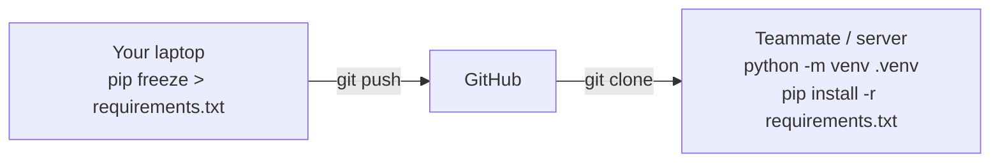

# Virtual Environments & pip

!!! abstract "Learning Objectives"
    By the end of this lesson, you can:

    - Install, upgrade and uninstall packages with `pip`
    - Explain why every project needs its own virtual environment
    - Create, activate and deactivate a virtual environment on Windows and macOS
    - Share dependencies with `requirements.txt`
    - Set up VS Code and Git correctly for a Python project

**Prerequisites:** [Modules & Packages](05-modules-and-packages.md)

## What is pip?

The standard library is big, but most real projects need **third-party packages** written by the community: `django`, `fastapi`, `requests`, `mysql-connector-python`, `pandas`. They live on **PyPI** (the Python Package Index, [pypi.org](https://pypi.org)), which hosts over half a million packages.

**pip** is Python's package installer. It downloads packages from PyPI and installs them.

!!! example "Real-life analogy: an app store"
    PyPI is like the Play Store or App Store for Python code, and `pip` is the "Install" button. `pip install requests` is like tapping Install on an app.

Check that pip is available:

=== "Windows"

    ```bash
    pip --version
    ```

=== "macOS"

    ```bash
    pip3 --version
    ```

```{ .text .output }
pip 24.2 from ... (python 3.12)
```

!!! tip "The safest way to call pip"
    `python -m pip install ...` (Windows) or `python3 -m pip install ...` (macOS) guarantees that pip installs into the **same Python** you run your code with. Inside an activated virtual environment, plain `pip` is fine.

## The Problem: Dependency Conflicts

Imagine two projects on your laptop:

- **Project A** (an old client project) needs **Django 4.2**
- **Project B** (your new capstone) needs **Django 5.1**

If you install packages globally, there's only **one** Django on your computer. Upgrading it for Project B breaks Project A.



A **virtual environment** (venv) is a private, isolated copy of Python **for one project**, with its own set of installed packages.

!!! example "Real-life analogy: separate kitchens"
    Cooking for a vegetarian restaurant and a non-veg restaurant in one shared kitchen causes mix-ups. Give each restaurant its own kitchen and own utensils, and nothing gets mixed. Each project gets its own venv.

## Creating and Activating a Virtual Environment

### Step 1: Create the project folder and venv

```bash
mkdir student-portal
cd student-portal
python -m venv .venv
```

On macOS use `python3 -m venv .venv`. This creates a folder called `.venv` containing a private Python and pip. The name `.venv` is a common convention.

### Step 2: Activate it

=== "Windows (Command Prompt)"

    ```bash
    .venv\Scripts\activate
    ```

=== "Windows (PowerShell)"

    ```bash
    .venv\Scripts\Activate.ps1
    ```

=== "macOS / Linux"

    ```bash
    source .venv/bin/activate
    ```

When it's active, your prompt shows the venv name:

```{ .text .output }
(.venv) C:\Users\ravi\student-portal>
```

Now `python` and `pip` refer to the venv's copies, and anything you install stays inside this project.

!!! mistake "Common Mistake: PowerShell blocks activation"
    On Windows PowerShell you may see `Activate.ps1 cannot be loaded because running scripts is disabled on this system`. Ask your trainer to help you allow local scripts for your user account, or use **Command Prompt** instead of PowerShell (`.venv\Scripts\activate`).

### Step 3: Verify

=== "Windows"

    ```bash
    where python
    ```

=== "macOS / Linux"

    ```bash
    which python
    ```

The path should point **inside** your project's `.venv` folder.

### Step 4: Deactivate when done

```bash
deactivate
```

!!! tip "One project, one venv"
    Create a fresh venv for every project, and activate it every time you open a new terminal to work on that project. If `pip install` "worked" but your code says `ModuleNotFoundError`, the venv probably wasn't active.

## Installing Packages with pip

With the venv active:

```bash
pip install requests
```

```{ .text .output }
Collecting requests
  Downloading requests-2.32.3-py3-none-any.whl (64 kB)
...
Successfully installed certifi charset-normalizer idna requests urllib3
```

pip also installed the packages that `requests` itself depends on.

Now use it:

```python
import requests

response = requests.get("https://api.github.com")
print(response.status_code)
```

```{ .text .output }
200
```

### Everyday pip commands

| Command | What it does |
|---------|--------------|
| `pip install django` | Install the latest version |
| `pip install django==5.1.2` | Install an exact version |
| `pip install "django>=5.0,<6"` | Install within a version range |
| `pip install --upgrade django` | Upgrade to the latest version |
| `pip uninstall django` | Remove a package |
| `pip list` | Show all installed packages |
| `pip show django` | Details: version, location, dependencies |
| `pip freeze` | List packages with exact versions (for requirements.txt) |

!!! warning "Install only trusted packages"
    Anyone can publish to PyPI. Attackers sometimes upload packages with names one letter off from popular ones (`reqeusts` instead of `requests`). Double-check spelling, and prefer well-known packages with many downloads and active maintenance.

## requirements.txt

Your teammate, your trainer or the production server needs **exactly the same packages and versions** you used. The standard way to share this is a `requirements.txt` file.

### Create it

```bash
pip freeze > requirements.txt
```

```text title="requirements.txt"
certifi==2024.8.30
charset-normalizer==3.4.0
Django==5.1.2
idna==3.10
requests==2.32.3
urllib3==2.2.3
```

### Install from it

On another machine, after creating and activating a fresh venv:

```bash
pip install -r requirements.txt
```

Every package is installed at the exact pinned version.



!!! realworld "In Real Projects"
    Every Python project on GitHub has a `requirements.txt` (or a `pyproject.toml`). Deployment platforms and Docker builds run `pip install -r requirements.txt` automatically. When a project "works on my machine" but not on the server, a missing or unpinned requirement is the usual culprit.

## Project Setup: VS Code and Git

### Select the interpreter in VS Code

1. Open the project folder in VS Code.
2. Press ++ctrl+shift+p++ (++cmd+shift+p++ on macOS) and choose **Python: Select Interpreter**.
3. Pick the one that shows `.venv`.

VS Code then uses the venv for running code, and its new terminals activate the venv automatically.

### Keep `.venv` out of Git

The `.venv` folder is large and machine-specific. **Never commit it.** Commit `requirements.txt` instead, and add a `.gitignore`:

```text title=".gitignore"
.venv/
__pycache__/
*.pyc
.env
```

`.env` holds secrets like database passwords. It must never go to GitHub either.

### A standard project layout

```text
student-portal/
├── .venv/               ← not committed
├── .gitignore
├── requirements.txt     ← committed
├── README.md
├── main.py
└── portal/
    ├── __init__.py
    ├── students.py
    └── reports.py
```

### Starting a new project: the checklist

```bash
mkdir my-project && cd my-project
python -m venv .venv
source .venv/bin/activate          # Windows: .venv\Scripts\activate
pip install django                 # whatever the project needs
pip freeze > requirements.txt
git init
```

Then add the `.gitignore` above before your first commit.

## Common Mistakes

| Mistake | Symptom | Fix |
|---------|---------|-----|
| Forgot to activate the venv | `ModuleNotFoundError` even after installing | Activate, then reinstall inside the venv |
| VS Code using the global Python | Imports underlined in red, code fails on Run | **Python: Select Interpreter** → `.venv` |
| Committed `.venv` to Git | Huge repo, broken on other machines | Add `.venv/` to `.gitignore`, remove it from Git |
| No `requirements.txt` | Teammates can't run the project | `pip freeze > requirements.txt` and commit it |
| `pip` installs into a different Python | Package "installed" but not found | Use `python -m pip install ...` |
| Typo in package name | Installs nothing, or a malicious look-alike | Check spelling on pypi.org |
| Moved or renamed the project folder | venv stops working | Delete `.venv`, recreate it, `pip install -r requirements.txt` |

## Practice Exercises

**Easy**

1. Create a folder `pip-practice`, create a venv in it, activate it and confirm with `which python` / `where python` that it's active.
2. Install `requests` and use `pip show requests` to find its version and dependencies.
3. Run `pip list` before and after installing `requests`. How many packages were added?

**Medium**

4. Install `django==5.1.2`, check the version with `python -m django --version`, then upgrade it with `--upgrade` and check again.
5. Create a `requirements.txt` with `pip freeze`. Delete the `.venv` folder, recreate it, and reinstall everything from the file.
6. Write a `.gitignore` for a Python project and explain each line.

**Challenge**

7. Create a project `weather-cli` with a venv, install `requests`, and write `main.py` that calls the free API `https://api.open-meteo.com/v1/forecast?latitude=17.38&longitude=78.48&current_weather=true` (Hyderabad) and prints the current temperature and wind speed. Add `requirements.txt`, `.gitignore` and a `README.md` with setup instructions, so a classmate can clone and run it in three commands.

??? success "Solutions (click to expand)"

    ```bash
    # 1
    mkdir pip-practice && cd pip-practice
    python -m venv .venv
    source .venv/bin/activate        # Windows: .venv\Scripts\activate
    which python                     # Windows: where python

    # 2
    pip install requests
    pip show requests

    # 3: a fresh venv lists only pip; requests adds 5 packages
    #    (requests, certifi, charset-normalizer, idna, urllib3)

    # 4
    pip install django==5.1.2
    python -m django --version
    pip install --upgrade django
    python -m django --version

    # 5
    pip freeze > requirements.txt
    deactivate
    rm -rf .venv                     # Windows: rmdir /s /q .venv
    python -m venv .venv
    source .venv/bin/activate
    pip install -r requirements.txt
    ```

    ```text title=".gitignore"
    # Virtual environment: large and machine-specific
    .venv/
    # Compiled bytecode caches and files
    __pycache__/
    *.pyc
    # Secrets (passwords, API keys)
    .env
    ```

    In `.gitignore`, comments must be on their own line starting with `#`. Text after a pattern on the same line becomes part of the pattern.

    ```python title="main.py"
    # 7
    import requests

    URL = (
        "https://api.open-meteo.com/v1/forecast"
        "?latitude=17.38&longitude=78.48&current_weather=true"
    )

    def main():
        response = requests.get(URL, timeout=10)
        response.raise_for_status()
        weather = response.json()["current_weather"]
        print(f"Hyderabad: {weather['temperature']}°C, wind {weather['windspeed']} km/h")

    if __name__ == "__main__":
        main()
    ```

    README setup steps: `git clone ...`, `python -m venv .venv && source .venv/bin/activate`, `pip install -r requirements.txt && python main.py`.

!!! note "Mini Assignment: module capstone"
    Turn your `student_manager` package from the previous lesson into a proper project: create a venv, add a third-party package (`tabulate`, to print the report as a neat table), generate `requirements.txt`, add `.gitignore` and a `README.md`, and push it to a new GitHub repository. Share the repo link with your trainer. A classmate should be able to clone and run it using only your README.

## Interview Questions

!!! interview "1. What is a virtual environment and why is it used?"
    An isolated Python environment with its own interpreter and installed packages, created per project with `python -m venv .venv`. It prevents version conflicts between projects, keeps the global Python clean, and makes dependencies reproducible.

!!! interview "2. What is pip?"
    Python's package installer. It downloads and installs packages and their dependencies from PyPI (or other indexes), and manages them with commands like `install`, `uninstall`, `list`, `show` and `freeze`.

!!! interview "3. What is `requirements.txt` and how do you create and use it?"
    A file listing a project's dependencies, usually with pinned versions. Create it with `pip freeze > requirements.txt`; install from it with `pip install -r requirements.txt` in a fresh environment.

!!! interview "4. Should the virtual environment folder be committed to Git?"
    No. It's large, contains machine- and OS-specific files, and can be recreated from `requirements.txt`. Add `.venv/` to `.gitignore`.

!!! interview "5. What is the difference between `pip install x` and `python -m pip install x`?"
    `python -m pip` runs the pip that belongs to that exact `python` interpreter, so the package installs where your code will run. A bare `pip` might belong to a different Python on the system, which causes "installed but not found" errors.

!!! interview "Scenario: a project runs on your machine but a new teammate gets `ModuleNotFoundError: No module named 'django'`. What steps do you give them?"
    Clone the repo, create a venv (`python -m venv .venv`), activate it, run `pip install -r requirements.txt`, and select the `.venv` interpreter in VS Code. If the error persists, check that `requirements.txt` actually lists Django, and regenerate it with `pip freeze` if it doesn't.

## Summary

| Task | Command |
|------|---------|
| Create venv | `python -m venv .venv` |
| Activate (Windows) | `.venv\Scripts\activate` |
| Activate (macOS/Linux) | `source .venv/bin/activate` |
| Deactivate | `deactivate` |
| Install / exact version | `pip install pkg` / `pip install pkg==1.2.3` |
| Upgrade / remove | `pip install --upgrade pkg` / `pip uninstall pkg` |
| Inspect | `pip list`, `pip show pkg` |
| Save dependencies | `pip freeze > requirements.txt` |
| Install dependencies | `pip install -r requirements.txt` |
| Git | Commit `requirements.txt`; ignore `.venv/` and `.env` |

🎉 **You've completed the Functions & Modules module!** Next up: **OOP & Advanced Python**, covering classes, objects, exceptions and file handling.
