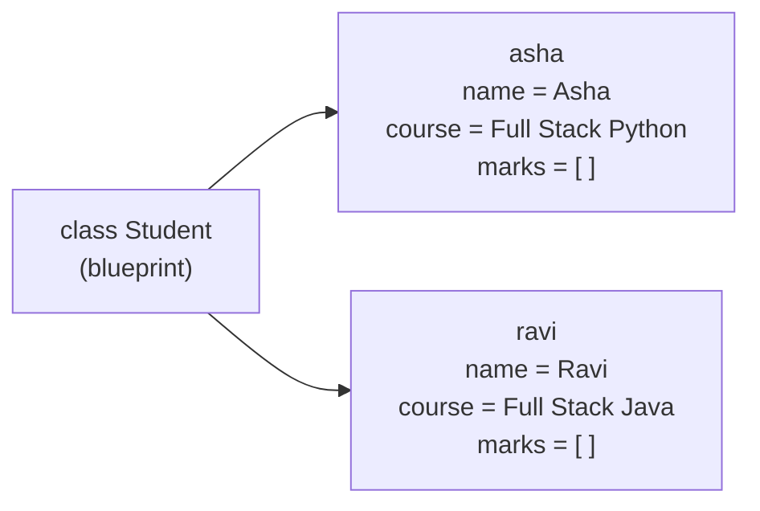

# Classes & Objects

!!! abstract "Learning Objectives"
    By the end of this lesson, you can:

    - Explain what object-oriented programming (OOP) is and why it's used
    - Define a class and create objects from it
    - Use `__init__` and `self` to give each object its own data
    - Write instance methods that read and change an object's data
    - Make objects print nicely with `__str__`

**Prerequisites:** [Functions & Modules](../functions/index.md), especially [Functions](../functions/01-functions.md) and [Dictionaries](../foundation/12-dictionaries.md).

!!! info "How this lesson is organised"
    **Part A** (sections 1 to 3) builds the idea: what a class is and how an object gets its data.
    **Part B** (sections 4 to 6) adds behaviour: methods, a real-world class and printing.
    Each part ends with a short **checkpoint**. Try it before moving on.

## What is Object-Oriented Programming?

So far, you've stored data in variables and dictionaries and written separate functions to work on it:

```python
student = {"name": "Asha", "marks": [85, 92, 78]}

def average(student):
    return sum(student["marks"]) / len(student["marks"])

print(average(student))
```

```{ .text .output }
85.0
```

This works, but as programs grow, the data and the functions that use it drift apart. Nothing stops someone from passing the wrong dictionary to `average()`, or from forgetting which functions belong to a student.

**Object-Oriented Programming (OOP)** keeps the data and its functions **together** in one unit called an **object**.

An object bundles:

- **Attributes**: the data it holds (`name`, `marks`)
- **Methods**: the actions it can do (`average()`, `add_mark()`)

!!! example "Real-life analogy: a blueprint and houses"
    An architect draws **one blueprint** for a house: 3 rooms, 1 kitchen, a door. From that blueprint, builders construct **many houses**. Each house has its own colour and its own owner, but all follow the same design.

    A **class** is the blueprint. An **object** is a house built from it.

| Term | Meaning | Example |
|------|---------|---------|
| **Class** | A blueprint that defines attributes and methods | `Student` |
| **Object / instance** | One thing created from a class | `asha`, `ravi` |
| **Attribute** | Data stored in an object | `asha.name` |
| **Method** | A function that belongs to a class | `asha.average()` |

You've been using objects all along: `"hello".upper()` calls the `upper` **method** of a `str` **object**, and `[1, 2].append(3)` calls a method of a `list` object. In this lesson you learn to create your own kinds of objects.

## Defining a Class and Creating Objects

```python
class Student:
    pass

asha = Student()
ravi = Student()

print(type(asha))
print(asha is ravi)
```

```{ .text .output }
<class '__main__.Student'>
False
```

- `class Student:` defines a class. Class names use **PascalCase** (`Student`, `BankAccount`, `OrderItem`).
- `Student()` creates (or **instantiates**) a new object.
- `asha` and `ravi` are two **separate** objects of the same class, which is why `asha is ravi` is `False`.

An empty class isn't useful yet. Let's give objects data.

## The `__init__` Method and `self`

`__init__` is a special method that runs **automatically** whenever a new object is created. It sets up the object's starting data. (It's often called the **constructor**.)

```python
class Student:
    def __init__(self, name, course):
        self.name = name
        self.course = course
        self.marks = []

asha = Student("Asha", "Full Stack Python")
ravi = Student("Ravi", "Full Stack Java")

print(asha.name, "-", asha.course)
print(ravi.name, "-", ravi.course)
print(asha.marks)
```

```{ .text .output }
Asha - Full Stack Python
Ravi - Full Stack Java
[]
```

### What is `self`?

`self` is **the object that's being created or used**. When you write `Student("Asha", "Full Stack Python")`, Python does three things:

1. It creates a new empty object.
2. It calls `__init__(new_object, "Asha", "Full Stack Python")`, so `self` **is** that new object.
3. `self.name = name` stores `"Asha"` **on that object**.



One class, two objects, and each object has its **own** copy of `name`, `course` and `marks`.

!!! tip "Remember"
    - `self` must be the **first parameter** of every regular method.
    - You never pass `self` yourself; Python passes it automatically.
    - `self.name` is the object's attribute; plain `name` is just the parameter, and it disappears when `__init__` finishes.

!!! mistake "Common Mistake: forgetting `self`"
    ```python
    class Student:
        def __init__(name, course):
            name = name

    asha = Student("Asha", "Python")
    ```

    ```{ .text .output }
    TypeError: Student.__init__() takes 2 positional arguments but 3 were given
    ```

    Python passed the object **plus** your two arguments, which makes three. Always write `def __init__(self, name, course):` and store values with `self.name = name`.

??? question "Checkpoint A: predict the output before you expand this"
    ```python
    class Counter:
        def __init__(self, start):
            self.value = start

    a = Counter(5)
    b = Counter(5)
    b.value = 9
    print(a.value, b.value)
    print(a is b)
    ```

    **Answer:**

    ```{ .text .output }
    5 9
    False
    ```

    `a` and `b` are two separate objects. Changing `b.value` does not touch `a.value`, even though both started at 5.

    **Quick question:** what would `Counter()` (with no argument) do? It raises `TypeError: Counter.__init__() missing 1 required positional argument: 'start'`, because `__init__` needs a value for `start`.

!!! info "End of Part A"
    You can now define a class and give each object its own data. This is a good place to pause in class.

## Instance Methods

Methods are functions defined **inside** a class. They use `self` to read and change the object's own data.

```python
class Student:
    def __init__(self, name):
        self.name = name
        self.marks = []

    def add_mark(self, mark):
        self.marks.append(mark)

    def average(self):
        if not self.marks:
            return 0
        return sum(self.marks) / len(self.marks)

    def report(self):
        return f"{self.name}: {len(self.marks)} marks, average {self.average():.1f}"

asha = Student("Asha")
asha.add_mark(85)
asha.add_mark(92)
asha.add_mark(78)

ravi = Student("Ravi")
ravi.add_mark(66)

print(asha.report())
print(ravi.report())
```

```{ .text .output }
Asha: 3 marks, average 85.0
Ravi: 1 marks, average 66.0
```

Three things to notice:

- `asha.add_mark(85)` is really `Student.add_mark(asha, 85)` behind the scenes. That's how `self` gets its value.
- Each object keeps its **own** `marks` list. Adding a mark to `asha` does not change `ravi`.
- A method can call another method of the same object with `self.`, as `report()` does with `self.average()`.

Compare this with the dictionary version at the top of the lesson. The data (`name`, `marks`) and the functions (`add_mark`, `average`, `report`) now live in one place.

## A Real-World Example: BankAccount

```python
class BankAccount:
    def __init__(self, owner, balance=0):
        self.owner = owner
        self.balance = balance

    def deposit(self, amount):
        if amount <= 0:
            print("Deposit must be positive")
            return
        self.balance += amount
        print(f"Deposited ₹{amount}. Balance: ₹{self.balance}")

    def withdraw(self, amount):
        if amount > self.balance:
            print("Insufficient balance")
            return
        self.balance -= amount
        print(f"Withdrew ₹{amount}. Balance: ₹{self.balance}")

account = BankAccount("Kiran", 5000)
account.deposit(2000)
account.withdraw(10000)
account.withdraw(1500)
```

```{ .text .output }
Deposited ₹2000. Balance: ₹7000
Insufficient balance
Withdrew ₹1500. Balance: ₹5500
```

- `balance=0` is a default argument, exactly like the ones you used in [Arguments & Return Values](../functions/02-arguments-and-return-values.md). `BankAccount("Kiran")` starts with a zero balance.
- The **rules** of the account (no negative deposits, no overdraft) live inside the class, next to the data they protect.

!!! warning "This version has two weaknesses"
    1. Anyone can still write `account.balance = -99999` and skip the rules.
    2. A failed withdrawal only **prints** a message, so the calling code cannot tell that it failed.

    Both are fixed in the next lesson, [Class Members & Encapsulation](02-class-members-and-encapsulation.md). For now, focus on how the class is built.

!!! realworld "In Real Projects"
    In Django, every database table is a class: `class Product(models.Model)` with attributes like `name` and `price`. Each row becomes an **object**, so `product.price` reads a column and `product.save()` writes the row back. In FastAPI, request and response shapes are classes too (Pydantic models). OOP is the foundation of both frameworks.

## Printing Objects with `__str__`

Try printing one of your objects:

```python
class Product:
    def __init__(self, name, price):
        self.name = name
        self.price = price

p = Product("Laptop", 55000)
print(p)
```

```{ .text .output }
<__main__.Product object at 0x...>
```

Python doesn't know how you want a `Product` to look, so it prints the class name and a memory address. Define `__str__` to tell it:

```python
class Product:
    def __init__(self, name, price):
        self.name = name
        self.price = price

    def __str__(self):
        return f"{self.name} - ₹{self.price:,}"    # :, adds thousands separators

p = Product("Laptop", 55000)
print(p)
print(f"You bought: {p}")
```

```{ .text .output }
Laptop - ₹55,000
You bought: Laptop - ₹55,000
```

- `__str__` must **return** a string. It should not print.
- Python calls it automatically for `print(p)`, `str(p)` and inside f-strings.

Methods with double underscores on both sides, like `__init__` and `__str__`, are called **dunder** (double-underscore) methods. You never call them directly. Python calls them for you at the right moment: `__init__` when an object is created, `__str__` when it is printed. You'll meet more of them in the next lessons.

??? question "Checkpoint B: predict the output before you expand this"
    ```python
    class Dog:
        def __init__(self, name):
            self.name = name
            self.tricks = []

        def learn(self, trick):
            self.tricks.append(trick)

        def __str__(self):
            return f"{self.name} knows {len(self.tricks)} tricks"

    d1 = Dog("Bruno")
    d2 = Dog("Tommy")
    d1.learn("sit")
    d1.learn("roll")

    print(d1)
    print(d2)
    ```

    **Answer:**

    ```{ .text .output }
    Bruno knows 2 tricks
    Tommy knows 0 tricks
    ```

    Each dog has its own `tricks` list because the list is created inside `__init__` with `self.tricks = []`.

## Common Mistakes

| Mistake | Error / Result | Fix |
|---------|----------------|-----|
| Missing `self` in a method definition | `TypeError: ... takes 1 positional argument but 2 were given` | `def method(self, ...)` |
| `name = name` instead of `self.name = name` | Attribute never saved; later `AttributeError` | Store with `self.` |
| Misspelling `__init__` (e.g. `__int__` or `_init_`) | `TypeError: Student() takes no arguments` | Exactly two underscores on each side |
| Calling a method without `()` | Gets the method object, not the result | `asha.average()` |
| Using `average()` inside the class without `self.` | `NameError: name 'average' is not defined` | `self.average()` |
| Printing inside `__str__` instead of returning | `TypeError: __str__ returned non-string (type NoneType)` | `return` the string |
| Accessing an attribute that was never set | `AttributeError: 'Student' object has no attribute 'age'` | Set every attribute in `__init__` |

## Practice Exercises

**Easy**

1. Create a class `Book` with `title`, `author` and `price`. Create two books and print their details.
2. Add a method `apply_discount(percent)` to `Book` that reduces the price.
3. Add `__str__` to `Book` so `print(book)` shows `Atomic Habits by James Clear - ₹499`.

**Medium**

4. Create a class `Rectangle` with `length` and `width` and methods `area()`, `perimeter()` and `is_square()`.
5. Create a class `Playlist` with a `name` and an empty list of songs. Add methods `add_song(title)`, `remove_song(title)` (do nothing if the song isn't there) and `count()`.
6. Add `__str__` to `Playlist` so it prints the name followed by a numbered list of songs.

**Challenge**

7. Build a `ShoppingCart` class with methods `add_item(name, price, qty=1)` (adding an existing item increases its quantity), `remove_item(name)` and `total()`. Add `__str__` to print a neat bill with one line per item and a total line.

??? success "Solution 1, 2 and 3: Book"

    ```python
    class Book:
        def __init__(self, title, author, price):
            self.title = title
            self.author = author
            self.price = price

        def apply_discount(self, percent):
            self.price = round(self.price * (1 - percent / 100), 2)

        def __str__(self):
            return f"{self.title} by {self.author} - ₹{self.price}"

    b1 = Book("Atomic Habits", "James Clear", 499)
    b2 = Book("Wings of Fire", "A. P. J. Abdul Kalam", 350)
    print(b1)                 # Atomic Habits by James Clear - ₹499
    b2.apply_discount(10)
    print(b2)                 # Wings of Fire by A. P. J. Abdul Kalam - ₹315.0
    ```

??? success "Solution 4: Rectangle"

    ```python
    class Rectangle:
        def __init__(self, length, width):
            self.length = length
            self.width = width

        def area(self):
            return self.length * self.width

        def perimeter(self):
            return 2 * (self.length + self.width)

        def is_square(self):
            return self.length == self.width

    r = Rectangle(10, 4)
    print(r.area(), r.perimeter(), r.is_square())    # 40 28 False
    ```

??? success "Solution 5 and 6: Playlist"

    ```python
    class Playlist:
        def __init__(self, name):
            self.name = name
            self.songs = []

        def add_song(self, title):
            self.songs.append(title)

        def remove_song(self, title):
            if title in self.songs:
                self.songs.remove(title)

        def count(self):
            return len(self.songs)

        def __str__(self):
            lines = [self.name]
            for number, song in enumerate(self.songs, start=1):
                lines.append(f"{number}. {song}")
            return "\n".join(lines)

    p = Playlist("Morning Drive")
    p.add_song("Song A")
    p.add_song("Song B")
    p.remove_song("Song Z")       # not there: nothing happens
    print(p.count())              # 2
    print(p)
    # Morning Drive
    # 1. Song A
    # 2. Song B
    ```

??? success "Solution 7: ShoppingCart"

    ```python
    class ShoppingCart:
        def __init__(self):
            self.items = {}          # name -> [price, qty]

        def add_item(self, name, price, qty=1):
            if name in self.items:
                self.items[name][1] += qty
            else:
                self.items[name] = [price, qty]

        def remove_item(self, name):
            self.items.pop(name, None)

        def total(self):
            return sum(price * qty for price, qty in self.items.values())

        def __str__(self):
            lines = []
            for name, (price, qty) in self.items.items():
                lines.append(f"{name}: {qty} x ₹{price} = ₹{price * qty}")
            lines.append(f"Total: ₹{self.total()}")
            return "\n".join(lines)

    cart = ShoppingCart()
    cart.add_item("Keyboard", 1499)
    cart.add_item("Mouse", 799)
    cart.add_item("Mouse", 799)       # quantity becomes 2
    print(cart)
    # Keyboard: 1 x ₹1499 = ₹1499
    # Mouse: 2 x ₹799 = ₹1598
    # Total: ₹3097
    ```

!!! note "Mini Assignment"
    Start rewriting your `student_manager` project using classes. Create a `Student` class with a roll number, a name and a marks dictionary (`{"Python": 85}`), and methods `add_mark(subject, mark)`, `percentage()`, `grade()` and `__str__`. Create three students in a list and print each one. You'll add a `StudentManager` class in the next lesson.

## Interview Questions

!!! interview "1. What is the difference between a class and an object?"
    A class is a blueprint that defines attributes and methods. An object (instance) is a concrete thing created from that class, with its own attribute values. One class can produce many objects.

!!! interview "2. What is `self` in Python?"
    `self` refers to the current instance. It's passed automatically as the first argument to instance methods, so methods can read and modify that object's attributes. The name `self` is a convention, not a keyword.

!!! interview "3. What is `__init__`?"
    A special (dunder) method that Python calls automatically right after an object is created, to initialise its attributes. It's often called the constructor. (Technically `__new__` creates the object and `__init__` initialises it.)

!!! interview "4. What is the difference between a function and a method?"
    A function is defined on its own and called by name: `len(x)`. A method is a function defined inside a class and called on an object: `x.upper()`. A method automatically receives the object as its first argument (`self`).

!!! interview "5. What does `__str__` do?"
    It returns the readable string that `print()`, `str()` and f-strings show for an object. Without it, Python prints something like `<__main__.Product object at 0x...>`.

!!! interview "Scenario: `asha.average` prints `<bound method Student.average of ...>` instead of a number. Why?"
    The method was referenced but not called. Without `()`, Python gives back the method object itself. Write `asha.average()`.

## Summary

| Concept | Remember |
|---------|----------|
| OOP | Bundle data (attributes) and behaviour (methods) into objects |
| Class / object | Blueprint / thing built from it: `asha = Student("Asha")` |
| `__init__` | Runs automatically on creation; sets up attributes |
| `self` | The current object; first parameter of instance methods |
| Instance attribute | `self.name`, one per object |
| Instance method | `def report(self):`, called as `asha.report()` |
| `__str__` | Returns the text that `print(obj)` shows |
| Dunder methods | Double-underscore methods such as `__init__` and `__str__` that Python calls for you |

**Next lesson:** [Class Members & Encapsulation](02-class-members-and-encapsulation.md), sharing data across objects and protecting it.
