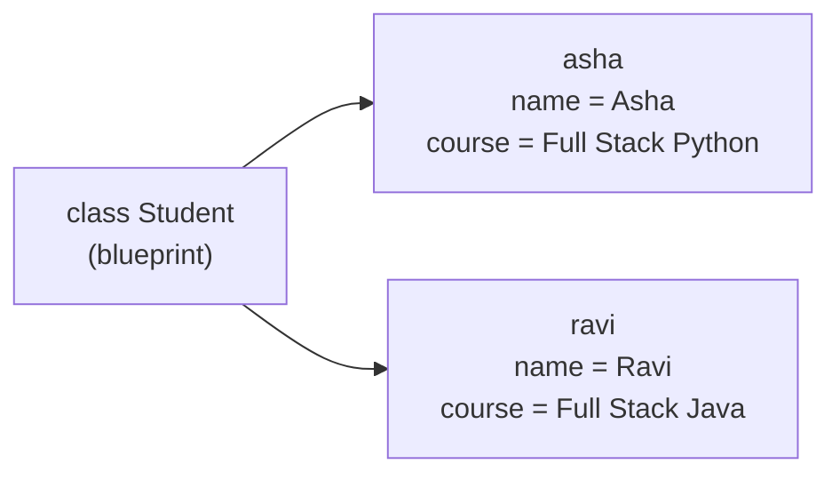

# Classes & Objects

!!! abstract "Learning Objectives"
    By the end of this lesson, you can:

    - Explain what object-oriented programming (OOP) is and why it's used
    - Define a class and create objects from it
    - Use `__init__` and `self` to give each object its own data
    - Write instance methods, class attributes, class methods and static methods
    - Make objects print nicely with `__str__`, and protect data with encapsulation

**Prerequisites:** [Functions & Modules](../functions/index.md), especially [Functions](../functions/01-functions.md) and [Dictionaries](../foundation/12-dictionaries.md).

## What is Object-Oriented Programming?

So far, you've stored data in variables and dictionaries and written separate functions to work on it:

```python
student = {"name": "Asha", "marks": [85, 92, 78]}

def average(student):
    return sum(student["marks"]) / len(student["marks"])

print(average(student))
```

```{ .text .output }
85.0
```

This works, but as programs grow, the data and the functions that use it drift apart. **Object-Oriented Programming (OOP)** keeps them **together** in one unit called an **object**.

An object bundles:

- **Attributes**: the data it holds (`name`, `marks`)
- **Methods**: the actions it can do (`average()`, `add_mark()`)

!!! example "Real-life analogy: a blueprint and houses"
    An architect draws **one blueprint** for a house: 3 rooms, 1 kitchen, a door. From that blueprint, builders construct **many houses**. Each house has its own colour and its own owner, but all follow the same design.

    A **class** is the blueprint. An **object** is a house built from it.

| Term | Meaning | Example |
|------|---------|---------|
| **Class** | A blueprint that defines attributes and methods | `Student` |
| **Object / instance** | One thing created from a class | `asha`, `ravi` |
| **Attribute** | Data stored in an object | `asha.name` |
| **Method** | A function that belongs to a class | `asha.average()` |

You've been using objects all along: `"hello".upper()` calls the `upper` **method** of a `str` **object**, and `[1, 2].append(3)` calls a method of a `list` object.

## Defining a Class and Creating Objects

```python
class Student:
    pass

asha = Student()
ravi = Student()

print(type(asha))
print(asha is ravi)
```

```{ .text .output }
<class '__main__.Student'>
False
```

- `class Student:` defines a class. Class names use **PascalCase** (`Student`, `BankAccount`, `OrderItem`).
- `Student()` creates (or **instantiates**) a new object.
- `asha` and `ravi` are two **separate** objects of the same class.

An empty class isn't useful yet. Let's give objects data.

## The __init__ Method and self

`__init__` is a special method that runs **automatically** whenever a new object is created. It sets up the object's starting data. (It's often called the **constructor**.)

```python
class Student:
    def __init__(self, name, course):
        self.name = name
        self.course = course
        self.marks = []

asha = Student("Asha", "Full Stack Python")
ravi = Student("Ravi", "Full Stack Java")

print(asha.name, "-", asha.course)
print(ravi.name, "-", ravi.course)
print(asha.marks)
```

```{ .text .output }
Asha - Full Stack Python
Ravi - Full Stack Java
[]
```

### What is `self`?

`self` is the object that's being created or used. When you write `Student("Asha", ...)`, Python:

1. creates a new empty object,
2. calls `__init__(new_object, "Asha", "Full Stack Python")`, so `self` **is** that new object,
3. and `self.name = name` stores `"Asha"` **on that object**.



!!! tip "Remember"
    - `self` must be the **first parameter** of every regular method.
    - You never pass `self` yourself; Python passes it automatically.
    - `self.name` is the object's attribute; plain `name` is just the parameter.

!!! mistake "Common Mistake: forgetting `self`"
    ```python
    class Student:
        def __init__(name, course):
            name = name

    asha = Student("Asha", "Python")
    ```

    ```{ .text .output }
    TypeError: Student.__init__() takes 2 positional arguments but 3 were given
    ```

    Python passed the object **plus** your two arguments. Always write `def __init__(self, name, course):` and store values with `self.name = name`.

## Instance Methods

Methods are functions defined inside a class. They use `self` to read and change the object's own data.

```python
class Student:
    def __init__(self, name):
        self.name = name
        self.marks = []

    def add_mark(self, mark):
        self.marks.append(mark)

    def average(self):
        if not self.marks:
            return 0
        return sum(self.marks) / len(self.marks)

    def report(self):
        return f"{self.name}: {len(self.marks)} marks, average {self.average():.1f}"

asha = Student("Asha")
asha.add_mark(85)
asha.add_mark(92)
asha.add_mark(78)

ravi = Student("Ravi")
ravi.add_mark(66)

print(asha.report())
print(ravi.report())
```

```{ .text .output }
Asha: 3 marks, average 85.0
Ravi: 1 marks, average 66.0
```

`asha.add_mark(85)` is really `Student.add_mark(asha, 85)` behind the scenes; that's how `self` gets its value. Each object keeps its **own** marks list.

A real-world example:

```python
class BankAccount:
    def __init__(self, owner, balance=0):
        self.owner = owner
        self.balance = balance

    def deposit(self, amount):
        if amount <= 0:
            return "Deposit must be positive"
        self.balance += amount
        return f"Deposited ₹{amount}. Balance: ₹{self.balance}"

    def withdraw(self, amount):
        if amount > self.balance:
            return "Insufficient balance"
        self.balance -= amount
        return f"Withdrew ₹{amount}. Balance: ₹{self.balance}"

account = BankAccount("Kiran", 5000)
print(account.deposit(2000))
print(account.withdraw(10000))
print(account.withdraw(1500))
```

```{ .text .output }
Deposited ₹2000. Balance: ₹7000
Insufficient balance
Withdrew ₹1500. Balance: ₹5500
```

!!! realworld "In Real Projects"
    In **Django**, every database table is a class: `class Product(models.Model)` with attributes like `name` and `price`. Each row becomes an object, so `product.price` reads a column and `product.save()` writes the row back. In **FastAPI**, request and response shapes are classes too (Pydantic models). OOP is the foundation of both frameworks.

## Class Attributes, Class Methods and Static Methods

### Instance attributes vs class attributes

- **Instance attributes** (`self.name`) belong to **one** object.
- **Class attributes** are defined directly in the class body and are **shared** by all objects.

```python
class Student:
    institute = "Kasi Yedumati Training"   # class attribute (shared)
    count = 0

    def __init__(self, name):
        self.name = name              # instance attribute
        Student.count += 1

a = Student("Asha")
b = Student("Ravi")

print(a.institute, "|", b.institute)
print("Students created:", Student.count)
```

```{ .text .output }
Kasi Yedumati Training | Kasi Yedumati Training
Students created: 2
```

### `@classmethod` and `@staticmethod`

| Kind | First parameter | Can use | Typical use |
|------|-----------------|---------|-------------|
| Instance method | `self` (the object) | object + class data | Most methods |
| `@classmethod` | `cls` (the class) | class data | Alternative constructors |
| `@staticmethod` | none | only its arguments | Helper related to the class |

```python
class Student:
    def __init__(self, name, email):
        self.name = name
        self.email = email

    @classmethod
    def from_csv(cls, line):
        name, email = line.split(",")
        return cls(name.strip(), email.strip())

    @staticmethod
    def is_valid_email(email):
        return "@" in email and "." in email.split("@")[-1]

s = Student.from_csv("Meena, meena@ksr.com")
print(s.name, s.email)
print(Student.is_valid_email("meena@ksr.com"))
print(Student.is_valid_email("meena.ksr.com"))
```

```{ .text .output }
Meena meena@ksr.com
True
False
```

## __str__, __repr__ and Encapsulation

### Printing objects nicely

```python
class Product:
    def __init__(self, name, price):
        self.name = name
        self.price = price

p = Product("Laptop", 55000)
print(p)
```

```{ .text .output }
<__main__.Product object at 0x...>
```

Define `__str__` to control what `print()` and `str()` show, and `__repr__` for a developer-friendly version (shown in the REPL and inside lists):

```python
class Product:
    def __init__(self, name, price):
        self.name = name
        self.price = price

    def __str__(self):
        return f"{self.name} - ₹{self.price:,}"

    def __repr__(self):
        return f"Product({self.name!r}, {self.price})"

p = Product("Laptop", 55000)
print(p)
print([p, Product("Mouse", 799)])
```

```{ .text .output }
Laptop - ₹55,000
[Product('Laptop', 55000), Product('Mouse', 799)]
```

Methods with double underscores on both sides (`__init__`, `__str__`, `__len__`, `__eq__`) are called **dunder** (double-underscore) or **magic** methods. Python calls them automatically for built-in operations.

### Encapsulation: protecting data

Anyone can currently set `account.balance = -99999`. **Encapsulation** means keeping an object's data safe and changing it only through methods that check the rules.

Python uses naming conventions:

| Name | Meaning |
|------|---------|
| `balance` | Public: anyone may use it |
| `_balance` | "Internal, please don't touch" (a convention) |
| `__balance` | Name-mangled: harder to access from outside |

Use `@property` to expose read-only data or validate changes:

```python
class BankAccount:
    def __init__(self, owner, balance=0):
        self.owner = owner
        self._balance = balance

    @property
    def balance(self):            # read like an attribute: account.balance
        return self._balance

    def deposit(self, amount):
        if amount <= 0:
            raise ValueError("Deposit must be positive")
        self._balance += amount

acc = BankAccount("Asha", 1000)
acc.deposit(500)
print(acc.balance)
acc.balance = 1_000_000
```

```{ .text .output }
1500
AttributeError: property 'balance' of 'BankAccount' object has no setter
```

The balance can be read, but it can only change through `deposit()`, which enforces the rules. `raise ValueError(...)` stops the program with an error message; you'll learn to handle errors properly in [Exception Handling](03-exception-handling.md).

## Common Mistakes

| Mistake | Error / Result | Fix |
|---------|---------------|-----|
| Missing `self` in a method definition | `TypeError: ... takes 1 positional argument but 2 were given` | `def method(self, ...)` |
| `name = name` instead of `self.name = name` | Attribute never saved; later `AttributeError` | Store with `self.` |
| Misspelling `__init__` (e.g. `__int__` or `_init_`) | `TypeError: Student() takes no arguments` | Exactly two underscores on each side |
| Calling a method without `()` | Gets the method object, not the result | `asha.average()` |
| Using a mutable class attribute for per-object data | All objects share one list | Create lists in `__init__` with `self.marks = []` |
| Accessing an attribute that was never set | `AttributeError: 'Student' object has no attribute 'age'` | Set every attribute in `__init__` |

!!! mistake "Common Mistake: shared mutable class attribute"
    ```python
    class Cart:
        items = []                  # shared by ALL carts!
        def add(self, item):
            self.items.append(item)

    a, b = Cart(), Cart()
    a.add("pen")
    print(b.items)
    ```

    ```{ .text .output }
    ['pen']
    ```

    Put per-object data in `__init__`: `self.items = []`.

## Practice Exercises

**Easy**

1. Create a class `Book` with `title`, `author` and `price`. Create two books and print their details.
2. Add a method `apply_discount(percent)` to `Book` that reduces the price.
3. Add `__str__` to `Book` so `print(book)` shows `"Atomic Habits by James Clear - ₹499"`.

**Medium**

4. Create a class `Rectangle` with `length` and `width` and methods `area()`, `perimeter()` and `is_square()`.
5. Create a class `Employee` with a class attribute `company = "Acme Tech"` and a class attribute that counts how many employees were created.
6. Add a `@classmethod` `from_string("Ravi-Developer-75000")` to `Employee` that creates an object from a dash-separated string.

**Challenge**

7. Build a `ShoppingCart` class with methods `add_item(name, price, qty=1)`, `remove_item(name)`, `total()` and `apply_coupon(code)` (`"SAVE10"` gives 10% off, `"FLAT500"` gives ₹500 off totals above ₹2000). Add `__str__` to print a neat bill and `__len__` to return the number of items.

??? success "Solutions (click to expand)"

    ```python
    # 1, 2, 3
    class Book:
        def __init__(self, title, author, price):
            self.title = title
            self.author = author
            self.price = price

        def apply_discount(self, percent):
            self.price = round(self.price * (1 - percent / 100), 2)

        def __str__(self):
            return f"{self.title} by {self.author} - ₹{self.price}"

    b1 = Book("Atomic Habits", "James Clear", 499)
    b2 = Book("Wings of Fire", "A. P. J. Abdul Kalam", 350)
    print(b1)
    b2.apply_discount(10)
    print(b2)                                 # Wings of Fire by A. P. J. Abdul Kalam - ₹315.0

    # 4
    class Rectangle:
        def __init__(self, length, width):
            self.length = length
            self.width = width

        def area(self):
            return self.length * self.width

        def perimeter(self):
            return 2 * (self.length + self.width)

        def is_square(self):
            return self.length == self.width

    r = Rectangle(10, 4)
    print(r.area(), r.perimeter(), r.is_square())    # 40 28 False

    # 5, 6
    class Employee:
        company = "Acme Tech"
        count = 0

        def __init__(self, name, role, salary):
            self.name = name
            self.role = role
            self.salary = salary
            Employee.count += 1

        @classmethod
        def from_string(cls, text):
            name, role, salary = text.split("-")
            return cls(name, role, int(salary))

    e1 = Employee("Asha", "Tester", 50000)
    e2 = Employee.from_string("Ravi-Developer-75000")
    print(e2.name, e2.role, e2.salary, Employee.company, Employee.count)
    # Ravi Developer 75000 Acme Tech 2

    # 7
    class ShoppingCart:
        def __init__(self):
            self.items = {}          # name -> [price, qty]
            self.discount = 0

        def add_item(self, name, price, qty=1):
            if name in self.items:
                self.items[name][1] += qty
            else:
                self.items[name] = [price, qty]

        def remove_item(self, name):
            self.items.pop(name, None)

        def subtotal(self):
            return sum(price * qty for price, qty in self.items.values())

        def apply_coupon(self, code):
            sub = self.subtotal()
            if code == "SAVE10":
                self.discount = sub * 0.10
            elif code == "FLAT500" and sub > 2000:
                self.discount = 500
            else:
                self.discount = 0

        def total(self):
            return self.subtotal() - self.discount

        def __len__(self):
            return sum(qty for _, qty in self.items.values())

        def __str__(self):
            lines = [f"{n:<10} {q} x ₹{p:,}" for n, (p, q) in self.items.items()]
            lines.append(f"{'Discount':<10} -₹{self.discount:,.2f}")
            lines.append(f"{'Total':<10} ₹{self.total():,.2f}")
            return "\n".join(lines)

    cart = ShoppingCart()
    cart.add_item("Keyboard", 1499)
    cart.add_item("Mouse", 799, 2)
    cart.apply_coupon("FLAT500")
    print(cart)
    print("Items:", len(cart))                # Items: 3
    ```

!!! note "Mini Assignment"
    Rewrite your `student_manager` project using classes: a `Student` class (roll number, name, marks dict, methods `add_mark()`, `percentage()`, `grade()`, `__str__`) and a `StudentManager` class that holds all students and has `add_student()`, `find(roll)`, `ranked()` and `report()`. The menu loop should only talk to `StudentManager`.

## Interview Questions

!!! interview "1. What is the difference between a class and an object?"
    A class is a blueprint that defines attributes and methods. An object (instance) is a concrete thing created from that class, with its own attribute values. One class can produce many objects.

!!! interview "2. What is `self` in Python?"
    `self` refers to the current instance. It's passed automatically as the first argument to instance methods, so methods can read and modify that object's attributes. The name `self` is a convention, not a keyword.

!!! interview "3. What is `__init__`?"
    A special (dunder) method that Python calls automatically right after an object is created, to initialise its attributes. It's often called the constructor. (Technically `__new__` creates the object and `__init__` initialises it.)

!!! interview "4. What is the difference between instance, class and static methods?"
    Instance methods take `self` and work with object data. Class methods (`@classmethod`) take `cls` and work with class-level data, and are often used as alternative constructors. Static methods (`@staticmethod`) take neither; they are plain functions grouped inside the class for organisation.

!!! interview "5. What is the difference between `__str__` and `__repr__`?"
    `__str__` returns a readable, user-friendly string (used by `print()` and `str()`). `__repr__` returns an unambiguous, developer-focused string, ideally one that looks like code to recreate the object (used in the REPL, in lists and by `repr()`). If `__str__` is missing, Python falls back to `__repr__`.

!!! interview "Scenario: you created two `Cart` objects, added an item to one, and it appeared in both. Why?"
    The list was defined as a **class attribute** (`items = []` in the class body), so it's shared by every instance. Move it into `__init__` as `self.items = []` so each cart gets its own list.

## Summary

| Concept | Remember |
|---------|----------|
| OOP | Bundle data (attributes) and behaviour (methods) into objects |
| Class / object | Blueprint / thing built from it: `asha = Student("Asha")` |
| `__init__` | Runs automatically on creation; sets up attributes |
| `self` | The current object; first parameter of instance methods |
| Instance attribute | `self.name`, one per object |
| Class attribute | Defined in the class body; shared by all objects |
| `@classmethod` / `@staticmethod` | Works with the class (`cls`) / plain helper |
| `__str__` / `__repr__` | Readable / developer view of an object |
| Encapsulation | `_internal` names, `@property`, validate in methods |

**Next lesson:** [Inheritance & Polymorphism](02-inheritance-and-polymorphism.md), reusing and extending classes.
