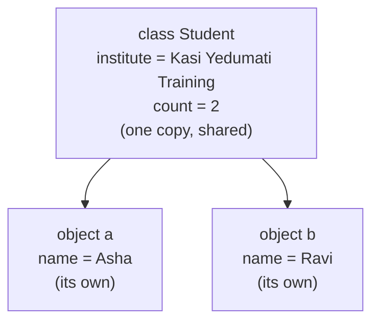

# Class Members & Encapsulation

!!! abstract "Learning Objectives"
    By the end of this lesson, you can:

    - Tell instance attributes from class attributes, and avoid the two classic traps
    - Write class methods and static methods, and know when to use each
    - Explain encapsulation and protect data with naming conventions and `@property`
    - Make objects comparable and readable with `__eq__` and `__repr__`
    - Use `@dataclass` to let Python write the repetitive parts of a class

**Prerequisites:** [Classes & Objects](01-classes-and-objects.md)

!!! info "How this lesson is organised"
    **Part A** (sections 1 to 4) covers things that belong to the **class** rather than to one object.
    **Part B** (sections 5 to 9) covers **encapsulation**, the first of the four pillars of OOP, and how to present objects well.

!!! tip "Type hints from here on"
    From this lesson onward, class code uses the type hints you learned in [Arguments & Return Values](../functions/02-arguments-and-return-values.md): `name: str`, `-> float`, and `-> None` for methods that return nothing. They don't change how the code runs. They make it easier to read, and FastAPI depends on them later.

## Instance Attributes vs Class Attributes

- **Instance attributes** (`self.name`) belong to **one object**. You create them in `__init__`.
- **Class attributes** are defined directly in the class body and are **shared by all objects**.

```python
class Student:
    institute = "Kasi Yedumati Training"   # class attribute (shared)
    count = 0                              # class attribute (shared)

    def __init__(self, name: str) -> None:
        self.name = name                   # instance attribute (one per object)
        Student.count += 1

a = Student("Asha")
b = Student("Ravi")

print(a.institute, "|", b.institute)
print(a.name, "|", b.name)
print("Students created:", Student.count)
```

```{ .text .output }
Kasi Yedumati Training | Kasi Yedumati Training
Asha | Ravi
Students created: 2
```



When you read `a.institute`, Python looks on the object `a` first. It doesn't find `institute` there, so it looks on the class and finds it. That lookup order explains both traps below.

| | Instance attribute | Class attribute |
|---|---|---|
| Where it's defined | Inside `__init__`, with `self.` | In the class body, no `self` |
| How many copies | One per object | One for the whole class |
| Use it for | Data that differs per object: name, marks, balance | Data common to all: company name, tax rate, counters |
| Change it with | `self.name = ...` | `ClassName.attr = ...` |

## Trap 1: Assigning Through `self` Creates a New Attribute

Reading a class attribute through an object works. **Assigning** through an object does not change the class attribute. It quietly creates a new instance attribute with the same name.

```python
class Student:
    count = 0

    def __init__(self, name: str) -> None:
        self.name = name
        self.count += 1        # BUG: creates self.count, leaves Student.count alone

a = Student("Asha")
b = Student("Ravi")

print(a.count, b.count, Student.count)
```

```{ .text .output }
1 1 0
```

`self.count += 1` means `self.count = self.count + 1`. The right side reads the class value `0`. The left side stores `1` on the **object**. The shared counter never moves.

**Fix:** change class attributes through the class name: `Student.count += 1`.

## Trap 2: A Mutable Class Attribute Is Shared by Everyone

```python
class Cart:
    items = []                  # shared by ALL carts!

    def add(self, item: str) -> None:
        self.items.append(item)

a = Cart()
b = Cart()
a.add("pen")
print(b.items)
```

```{ .text .output }
['pen']
```

`self.items.append(...)` does not assign anything. It finds the one shared list on the class and changes it, so every cart sees the pen.

**Fix:** per-object data belongs in `__init__`:

```python
class Cart:
    def __init__(self) -> None:
        self.items: list[str] = []      # a new list for every cart

    def add(self, item: str) -> None:
        self.items.append(item)

a = Cart()
b = Cart()
a.add("pen")
print(a.items, b.items)
```

```{ .text .output }
['pen'] []
```

!!! tip "Rule of thumb"
    If the value differs from object to object, or it's a list, dict or set, create it in `__init__`.

## Class Methods and Static Methods

So far every method took `self` and worked on one object. Two other kinds exist.

| Kind | First parameter | Can use | Typical use |
|------|-----------------|---------|-------------|
| Instance method | `self` (the object) | object + class data | Most methods |
| `@classmethod` | `cls` (the class) | class data | Alternative constructors |
| `@staticmethod` | none | only its arguments | Helper related to the class |

!!! note "What is the `@` line?"
    `@classmethod` and `@staticmethod` are **decorators**. For now, read the `@` line as a label that changes how the method below it behaves. You'll learn how decorators work, and write your own, in Decorators & Generators.

```python
class Student:
    def __init__(self, name: str, email: str) -> None:
        self.name = name
        self.email = email

    @classmethod
    def from_csv(cls, line: str) -> "Student":
        name, email = line.split(",")
        return cls(name.strip(), email.strip())     # cls is Student here

    @staticmethod
    def is_valid_email(email: str) -> bool:
        return "@" in email and "." in email.split("@")[-1]

s = Student.from_csv("Meena, meena@ksr.com")
print(s.name, s.email)
print(Student.is_valid_email("meena@ksr.com"))
print(Student.is_valid_email("meena.ksr.com"))
```

```{ .text .output }
Meena meena@ksr.com
True
False
```

- `from_csv` is an **alternative constructor**: a second way to build a `Student`, from a line of text instead of separate arguments. It needs `cls` so it can create the object.
- `is_valid_email` needs neither an object nor the class. It sits inside `Student` only because it's about students. That's what a static method is.
- Both are called on the **class**: `Student.from_csv(...)`, `Student.is_valid_email(...)`.
- The return hint `"Student"` is in quotes because the class is still being defined at that point.

**How to choose:** does the method need the object's data? Use an instance method. Does it need to create an object or use class-level data? Use `@classmethod`. Neither? Use `@staticmethod`.

??? question "Checkpoint A: predict the output before you expand this"
    ```python
    class Laptop:
        warranty_years = 1

        def __init__(self, brand: str) -> None:
            self.brand = brand

    a = Laptop("Dell")
    b = Laptop("HP")

    a.warranty_years = 3
    print(a.warranty_years, b.warranty_years, Laptop.warranty_years)

    Laptop.warranty_years = 2
    print(a.warranty_years, b.warranty_years, Laptop.warranty_years)
    ```

    **Answer:**

    ```{ .text .output }
    3 1 1
    3 2 2
    ```

    `a.warranty_years = 3` creates an instance attribute on `a` only (Trap 1). After that, `a` always finds its own value first. `b` has no value of its own, so it keeps following the class.

!!! info "End of Part A"
    You now know what belongs to the class and what belongs to each object. This is a good place to pause in class.

## What is Encapsulation?

Look again at the `BankAccount` from the last lesson. It checks for overdrafts inside `withdraw()`, but nothing stops this:

```python
class BankAccount:
    def __init__(self, owner: str, balance: float = 0) -> None:
        self.owner = owner
        self.balance = balance

account = BankAccount("Kiran", 5000)
account.balance = -99999          # no rule was checked
print(account.balance)
```

```{ .text .output }
-99999
```

**Encapsulation** means two things:

1. **Bundling** data and the methods that work on it into one unit (the class). You've been doing this since the last lesson.
2. **Protecting** that data, so it can only change through methods that check the rules.

!!! example "Real-life analogy: an ATM"
    You can't open the bank's vault and change your balance. You use the ATM's buttons: deposit, withdraw, check balance. Each button checks the rules first (correct PIN, enough money). The vault is the **data**, the buttons are the **methods**, and the machine around them is **encapsulation**.

Encapsulation is the first of the **four pillars of OOP**. The other three (inheritance, polymorphism and abstraction) come in the next two lessons.

## Public, Protected and Private Names

Python has no `private` keyword. It uses **naming conventions**:

| Name | Called | Meaning |
|------|--------|---------|
| `balance` | Public | Anyone may read and change it |
| `_balance` | Protected (by convention) | "Internal, please don't touch from outside" |
| `__balance` | Private (name-mangled) | Python renames it, so it's harder to reach from outside |

```python
class BankAccount:
    def __init__(self, owner: str) -> None:
        self.owner = owner            # public
        self._branch = "Hyderabad"    # internal by convention
        self.__pin = 1234             # name-mangled

acc = BankAccount("Asha")
print(acc.owner)
print(acc._branch)                # works, but you're breaking the convention
print(acc._BankAccount__pin)      # the mangled name still works
print(acc.__pin)
```

```{ .text .output }
Asha
Hyderabad
1234
AttributeError: 'BankAccount' object has no attribute '__pin'
```

- A single underscore changes nothing technically. It's a message to other developers: "this is internal".
- A double underscore makes Python rename the attribute to `_BankAccount__pin`. This is called **name mangling**. As the third `print` shows, it is **not** real privacy. It only prevents accidents.

!!! tip "What professionals actually use"
    Most Python code uses a **single underscore** plus `@property`. Double underscores are rare. Python's philosophy is "we're all adults here": conventions are trusted, not enforced.

## Controlled Access with `@property`

A **property** lets you write a method but use it like an attribute. That gives you a place to put rules without changing how the class is used.

### Read-only data

```python
class BankAccount:
    def __init__(self, owner: str, balance: float = 0) -> None:
        self.owner = owner
        self._balance = balance

    @property
    def balance(self) -> float:        # read like an attribute: acc.balance
        return self._balance

acc = BankAccount("Asha", 1000)
print(acc.balance)                     # no brackets
acc.balance = 1_000_000
```

```{ .text .output }
1000
AttributeError: property 'balance' of 'BankAccount' object has no setter
```

The real data lives in `_balance`. The outside world reads it through `balance`, and cannot assign to it.

### Validated changes with a setter

Sometimes outside code **should** be able to assign, as long as the value is sensible. Add a **setter**:

```python
class Product:
    def __init__(self, name: str, price: float) -> None:
        self.name = name
        self.price = price             # this line goes through the setter too

    @property
    def price(self) -> float:          # getter
        return self._price

    @price.setter
    def price(self, value: float) -> None:     # setter: runs on  p.price = ...
        if value <= 0:
            raise ValueError("Price must be positive")
        self._price = value

p = Product("Laptop", 55000)
p.price = 52000                        # allowed
print(p.price)
p.price = -10                          # rejected
```

```{ .text .output }
52000
ValueError: Price must be positive
```

- The getter and the setter have the **same name** (`price`). The decorator tells Python which is which.
- `raise ValueError(...)` stops the program with an error message. You'll learn to handle errors properly in Exception Handling.
- Because `__init__` uses `self.price = price`, even `Product("Pen", -5)` is rejected.

| You want | Write |
|----------|-------|
| Anyone can read and change freely | A plain attribute: `self.name` |
| Read from outside, change only through methods | `@property` with no setter |
| Change from outside, but with a rule | `@property` plus `@name.setter` |

## BankAccount, Done Properly

Here is the account with both weaknesses from the last lesson fixed:

```python
class BankAccount:
    def __init__(self, owner: str, balance: float = 0) -> None:
        self.owner = owner
        self._balance = balance

    @property
    def balance(self) -> float:
        return self._balance

    def deposit(self, amount: float) -> None:
        if amount <= 0:
            raise ValueError("Deposit must be positive")
        self._balance += amount

    def withdraw(self, amount: float) -> None:
        if amount <= 0:
            raise ValueError("Withdrawal must be positive")
        if amount > self._balance:
            raise ValueError("Insufficient balance")
        self._balance -= amount

acc = BankAccount("Asha", 1000)
acc.deposit(500)
acc.withdraw(300)
print(acc.balance)
acc.withdraw(5000)
```

```{ .text .output }
1200
ValueError: Insufficient balance
```

!!! tip "Why `raise` is better than printing or returning a message"
    In the last lesson, a failed withdrawal printed `"Insufficient balance"` and carried on. The code that called `withdraw()` had no way to know it failed, so it might go on to dispatch an order that was never paid for.

    Raising an error **cannot be ignored by accident**. The caller must deal with it or the program stops. Methods should return useful values or raise errors. They should not return or print error messages as text.

!!! realworld "In Real Projects"
    Django models use the same idea. A field such as `price = models.DecimalField(...)` is a class attribute, each row's value lives on the object, and methods like `full_clean()` enforce the rules before saving. Pydantic models in FastAPI validate every field on creation, exactly like the `price` setter above.

## Readable and Comparable Objects: `__repr__` and `__eq__`

Two more dunder methods fix two surprises.

```python
class Product:
    def __init__(self, name: str, price: float) -> None:
        self.name = name
        self.price = price

a = Product("Mouse", 799)
b = Product("Mouse", 799)

print(a == b)
print([a, b])
```

```{ .text .output }
False
[<__main__.Product object at 0x...>, <__main__.Product object at 0x...>]
```

- **Surprise 1:** `a == b` is `False` even though the data is identical. By default, `==` on your own objects asks "are these the **same object**?", just like `is`.
- **Surprise 2:** inside a list, objects show as memory addresses. A list uses `__repr__`, not `__str__`.

```python
class Product:
    def __init__(self, name: str, price: float) -> None:
        self.name = name
        self.price = price

    def __repr__(self) -> str:
        return f"Product({self.name!r}, {self.price})"    # !r shows the name with quotes

    def __eq__(self, other: object) -> bool:
        if not isinstance(other, Product):                # comparing with a non-Product
            return False
        return self.name == other.name and self.price == other.price

a = Product("Mouse", 799)
b = Product("Mouse", 799)

print(a == b)
print(a is b)
print([a, b])
```

```{ .text .output }
True
False
[Product('Mouse', 799), Product('Mouse', 799)]
```

| Method | Python calls it for | Should return |
|--------|---------------------|---------------|
| `__str__` | `print(obj)`, `str(obj)`, f-strings | A friendly string for users |
| `__repr__` | The REPL, objects inside lists and dicts, debuggers | A precise string for developers, ideally code that recreates the object |
| `__eq__` | `a == b` | `True` or `False` |

If a class has `__repr__` but no `__str__`, `print()` uses `__repr__`. So if you write only one, write `__repr__`.

`==` and `is` now answer different questions: `==` asks "same **data**?", `is` asks "same **object**?".

## Less Typing with `@dataclass`

Look at what you've been writing: `__init__` copies each argument to `self`, `__repr__` lists the attributes, `__eq__` compares them. It's the same pattern every time, so Python can write it for you.

```python
from dataclasses import dataclass

@dataclass
class Product:
    name: str
    price: float
    in_stock: bool = True              # default value

    def discounted(self, percent: float) -> float:
        return self.price * (1 - percent / 100)

a = Product("Mouse", 800)
b = Product("Mouse", 800)

print(a)
print(a == b)
print(a.discounted(10))
```

```{ .text .output }
Product(name='Mouse', price=800, in_stock=True)
True
720.0
```

- You list the attributes with their types. `@dataclass` generates `__init__`, `__repr__` and `__eq__`.
- You can still add your own methods, such as `discounted()`.
- These are **instance** attributes, even though they're written in the class body. The decorator moves them into the `__init__` it generates.

!!! mistake "Common Mistake: a list as a dataclass default"
    ```python
    from dataclasses import dataclass

    @dataclass
    class Cart:
        items: list = []
    ```

    ```{ .text .output }
    ValueError: mutable default <class 'list'> for field items is not allowed: use default_factory
    ```

    This is Trap 2 again, and dataclasses refuse to let you fall into it. Use `field(default_factory=list)`:

    ```python
    from dataclasses import dataclass, field

    @dataclass
    class Cart:
        items: list[str] = field(default_factory=list)   # a new list per cart

    a = Cart()
    b = Cart()
    a.items.append("pen")
    print(a.items, b.items)
    ```

    ```{ .text .output }
    ['pen'] []
    ```

**When to use which:** use `@dataclass` for classes that mainly **hold data** (a product, an address, an order line). Write a normal class when it has real behaviour and rules to protect, like `BankAccount`.

!!! realworld "In Real Projects"
    A Pydantic model in FastAPI looks almost identical: `class Product(BaseModel):` followed by `name: str` and `price: float`. Once you can read a dataclass, you can read every request and response model in the FastAPI module.

??? question "Checkpoint B: predict the output before you expand this"
    ```python
    class Temperature:
        def __init__(self, celsius: float) -> None:
            self.celsius = celsius

        @property
        def celsius(self) -> float:
            return self._celsius

        @celsius.setter
        def celsius(self, value: float) -> None:
            if value < -273.15:
                raise ValueError("Below absolute zero")
            self._celsius = value

        @property
        def fahrenheit(self) -> float:
            return self._celsius * 9 / 5 + 32

    t = Temperature(25)
    print(t.fahrenheit)
    t.celsius = 100
    print(t.fahrenheit)
    t.fahrenheit = 50
    ```

    **Answer:**

    ```{ .text .output }
    77.0
    212.0
    AttributeError: property 'fahrenheit' of 'Temperature' object has no setter
    ```

    `fahrenheit` is a **computed** property: it's calculated from `_celsius` each time, so it's always up to date. It has no setter, so it's read-only.

## Common Mistakes

| Mistake | Error / Result | Fix |
|---------|----------------|-----|
| `self.count += 1` for a shared counter | Each object gets its own `count`; the class value never changes | `ClassName.count += 1` |
| Mutable class attribute for per-object data | All objects share one list | Create it in `__init__` |
| Forgetting `cls` in a `@classmethod` | `TypeError: ... takes 1 positional argument but 2 were given` | `def from_csv(cls, line):` |
| Calling a property with brackets: `acc.balance()` | `TypeError: 'int' object is not callable` | `acc.balance` |
| Property and its storage share a name: `return self.balance` inside `balance` | `RecursionError: maximum recursion depth exceeded` | Store in `self._balance` |
| Assigning to a property with no setter | `AttributeError: property '...' has no setter` | Add `@name.setter`, or change it through a method |
| Expecting `__balance` to be truly private | Still reachable as `_ClassName__balance` | Treat it as a convention, not security |
| Comparing objects with `==` without `__eq__` | Always `False` for different objects | Define `__eq__` or use `@dataclass` |

## Practice Exercises

**Easy**

1. Create a class `Employee` with a class attribute `company = "Acme Tech"` and instance attributes `name` and `salary`. Create two employees and print the company through both.
2. Add a class attribute `count` to `Employee` that tracks how many employees were created.
3. Add a `@staticmethod` `is_valid_salary(amount)` that returns `True` only for amounts above zero.

**Medium**

4. Add a `@classmethod` `from_string("Ravi-75000")` to `Employee` that creates an object from a dash-separated string.
5. Make `salary` a property with a setter that rejects values of zero or below with a `ValueError`.
6. Write a `Point` class with `x` and `y`, plus `__repr__` and `__eq__`. Then write the same class as a `@dataclass` and confirm it behaves the same.

**Challenge**

7. Build a `Wallet` class: a read-only `balance` property, `add_money(amount)` and `pay(amount)` that raise `ValueError` on bad input, a class attribute `MAX_BALANCE = 100_000` that `add_money` respects, and a read-only `transactions` property that returns a **copy** of the internal list of `("add", 500)` style tuples, so outside code can't edit the history.

??? success "Solution 1 to 5: Employee"

    ```python
    class Employee:
        company = "Acme Tech"
        count = 0

        def __init__(self, name: str, salary: float) -> None:
            self.name = name
            self.salary = salary            # goes through the setter
            Employee.count += 1

        @property
        def salary(self) -> float:
            return self._salary

        @salary.setter
        def salary(self, value: float) -> None:
            if not Employee.is_valid_salary(value):
                raise ValueError("Salary must be above zero")
            self._salary = value

        @staticmethod
        def is_valid_salary(amount: float) -> bool:
            return amount > 0

        @classmethod
        def from_string(cls, text: str) -> "Employee":
            name, salary = text.split("-")
            return cls(name, int(salary))

    e1 = Employee("Asha", 50000)
    e2 = Employee.from_string("Ravi-75000")
    print(e1.company, e2.company)             # Acme Tech Acme Tech
    print(e2.name, e2.salary, Employee.count) # Ravi 75000 2
    e1.salary = 55000
    print(e1.salary)                          # 55000
    ```

??? success "Solution 6: Point, two ways"

    ```python
    from dataclasses import dataclass

    class Point:
        def __init__(self, x: int, y: int) -> None:
            self.x = x
            self.y = y

        def __repr__(self) -> str:
            return f"Point(x={self.x}, y={self.y})"

        def __eq__(self, other: object) -> bool:
            if not isinstance(other, Point):
                return False
            return self.x == other.x and self.y == other.y

    @dataclass
    class DataPoint:
        x: int
        y: int

    print(Point(1, 2), Point(1, 2) == Point(1, 2))               # Point(x=1, y=2) True
    print(DataPoint(1, 2), DataPoint(1, 2) == DataPoint(1, 2))   # DataPoint(x=1, y=2) True
    ```

??? success "Solution 7: Wallet"

    ```python
    class Wallet:
        MAX_BALANCE = 100_000

        def __init__(self, owner: str) -> None:
            self.owner = owner
            self._balance = 0
            self._transactions: list[tuple[str, float]] = []

        @property
        def balance(self) -> float:
            return self._balance

        @property
        def transactions(self) -> list[tuple[str, float]]:
            return list(self._transactions)        # a copy, so the original is safe

        def add_money(self, amount: float) -> None:
            if amount <= 0:
                raise ValueError("Amount must be positive")
            if self._balance + amount > Wallet.MAX_BALANCE:
                raise ValueError("Wallet limit exceeded")
            self._balance += amount
            self._transactions.append(("add", amount))

        def pay(self, amount: float) -> None:
            if amount <= 0:
                raise ValueError("Amount must be positive")
            if amount > self._balance:
                raise ValueError("Insufficient balance")
            self._balance -= amount
            self._transactions.append(("pay", amount))

    w = Wallet("Asha")
    w.add_money(2000)
    w.pay(750)
    print(w.balance)                  # 1250
    history = w.transactions
    history.clear()                   # clears only the copy
    print(w.transactions)             # [('add', 2000), ('pay', 750)]
    ```

!!! note "Mini Assignment"
    Continue your class-based `student_manager`. Make each mark validated (0 to 100) inside `add_mark()` by raising `ValueError`, add `__repr__` and `__eq__` to `Student` (two students are equal if their roll numbers match), and add a class method `Student.from_line("101,Asha")`. Then write a `StudentManager` class that holds all students and has `add_student()`, `find(roll)`, `ranked()` and `report()`. The menu loop should only talk to `StudentManager`.

## Interview Questions

!!! interview "1. What is the difference between instance attributes and class attributes?"
    Instance attributes are created with `self.` (usually in `__init__`) and each object has its own copy. Class attributes are defined in the class body and shared by all instances. Assigning through an instance (`obj.attr = x`) creates an instance attribute that hides the class one.

!!! interview "2. What is the difference between instance, class and static methods?"
    Instance methods take `self` and work with object data. Class methods (`@classmethod`) take `cls` and work with class-level data, and are often used as alternative constructors. Static methods (`@staticmethod`) take neither; they are plain functions grouped inside the class for organisation.

!!! interview "3. What is encapsulation? How does Python implement it?"
    Encapsulation is bundling data with the methods that operate on it and restricting direct access to the data, so it changes only through controlled methods. Python has no access modifiers; it uses conventions (`_name` for internal, `__name` for name-mangled) and `@property` for controlled access.

!!! interview "4. Does Python have private variables?"
    Not truly. A double-underscore attribute is name-mangled to `_ClassName__attr`, which avoids accidental access and clashes in subclasses, but it can still be reached. Privacy in Python is by convention.

!!! interview "5. What is `@property` and why use it?"
    It turns a method into a read-only attribute, and with `@name.setter` it lets you validate assignments. It gives controlled access while keeping simple attribute syntax, so you can add validation later without changing the code that uses the class.

!!! interview "6. What is the difference between `__str__` and `__repr__`? And between `==` and `is`?"
    `__str__` returns a readable, user-friendly string (used by `print()` and `str()`). `__repr__` returns an unambiguous, developer-focused string (used in the REPL and inside containers); if `__str__` is missing, Python falls back to `__repr__`. `==` compares values by calling `__eq__`; `is` checks whether two names refer to the same object.

!!! interview "Scenario: you created two `Cart` objects, added an item to one, and it appeared in both. Why?"
    The list was defined as a **class attribute** (`items = []` in the class body), so it's shared by every instance. Move it into `__init__` as `self.items = []` so each cart gets its own list.

## Summary

| Concept | Remember |
|---------|----------|
| Instance attribute | `self.name`, one per object |
| Class attribute | Defined in the class body; shared by all objects; change with `ClassName.attr` |
| `@classmethod` | Gets `cls`; used for alternative constructors |
| `@staticmethod` | Gets neither; a helper that lives in the class |
| Encapsulation | Bundle data with methods and protect it behind rules |
| `_name` / `__name` | Internal by convention / name-mangled; neither is true privacy |
| `@property` | Read like an attribute; add `@name.setter` to validate changes |
| `raise ValueError(...)` | Signal a broken rule instead of printing a message |
| `__repr__` / `__eq__` | Developer view of an object / what `==` means |
| `@dataclass` | Generates `__init__`, `__repr__` and `__eq__` for data-holding classes |

**Next lesson:** [Inheritance](03-inheritance.md), reusing and extending classes.
