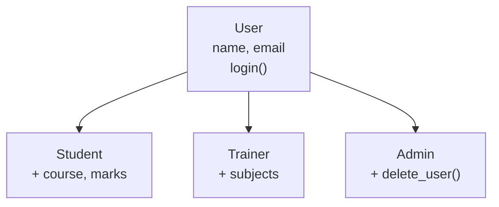

# Inheritance & Polymorphism

!!! abstract "Learning Objectives"
    By the end of this lesson, you can:

    - Create child classes that inherit from a parent class
    - Extend a parent's `__init__` with `super()`
    - Override methods to change behaviour in a child class
    - Use polymorphism to treat different objects the same way
    - Define abstract base classes and choose between inheritance and composition

**Prerequisites:** [Classes & Objects](01-classes-and-objects.md)

## What is Inheritance?

**Inheritance** lets a new class **reuse** everything from an existing class and add or change only what's different.

- The existing class is the **parent** (also called base class or superclass).
- The new class is the **child** (also called derived class or subclass).

!!! example "Real-life analogy: family traits"
    Children inherit features from their parents (eye colour, surname) but also have their own unique traits. A child class gets all of the parent's attributes and methods for free, and can add new ones or change existing ones.

Without inheritance, similar classes repeat the same code:

```python
class Student:
    def __init__(self, name, email):
        self.name = name
        self.email = email
    def login(self):
        return f"{self.name} logged in"

class Trainer:
    def __init__(self, name, email):
        self.name = name                 # repeated
        self.email = email               # repeated
    def login(self):                     # repeated
        return f"{self.name} logged in"
```

With inheritance, the shared parts live in **one** parent class:

```python
class User:
    def __init__(self, name, email):
        self.name = name
        self.email = email

    def login(self):
        return f"{self.name} logged in"

class Student(User):        # Student inherits from User
    pass

class Trainer(User):
    pass

s = Student("Asha", "asha@ksr.com")
t = Trainer("Kiran", "kiran@ksr.com")
print(s.login())
print(t.login())
print(isinstance(s, User), issubclass(Trainer, User))
```

```{ .text .output }
Asha logged in
Kiran logged in
True True
```

`class Student(User):` means "Student **is a** User". Inheritance models **"is-a"** relationships: a Student is a User, a Car is a Vehicle, a SavingsAccount is a BankAccount.



## Extending __init__ with super()

Child classes usually need **extra** attributes. Use `super()` to call the parent's `__init__` so you don't repeat its code:

```python
class User:
    def __init__(self, name, email):
        self.name = name
        self.email = email

    def login(self):
        return f"{self.name} logged in"

class Student(User):
    def __init__(self, name, email, course):
        super().__init__(name, email)     # let the parent set name and email
        self.course = course              # then add the child's own data

    def enroll_message(self):
        return f"{self.name} is enrolled in {self.course}"

s = Student("Asha", "asha@ksr.com", "Full Stack Python")
print(s.login())              # inherited
print(s.enroll_message())     # Student's own
```

```{ .text .output }
Asha logged in
Asha is enrolled in Full Stack Python
```

!!! mistake "Common Mistake: forgetting `super().__init__()`"
    ```python
    class Student(User):
        def __init__(self, name, email, course):
            self.course = course          # parent's __init__ never runs

    s = Student("Asha", "asha@ksr.com", "Python")
    print(s.name)
    ```

    ```{ .text .output }
    AttributeError: 'Student' object has no attribute 'name'
    ```

    When a child defines its own `__init__`, the parent's no longer runs automatically. Call `super().__init__(...)` first.

## Method Overriding

A child can **override** a parent method by defining a method with the **same name**. The child's version is used for child objects.

```python
class User:
    def __init__(self, name):
        self.name = name

    def dashboard(self):
        return f"Welcome {self.name}"

class Student(User):
    def dashboard(self):
        return f"Welcome {self.name}: your courses and assignments"

class Admin(User):
    def dashboard(self):
        base = super().dashboard()        # reuse the parent's version
        return base + " | Admin panel: users, payments, reports"

print(User("Guest").dashboard())
print(Student("Asha").dashboard())
print(Admin("Ravi").dashboard())
```

```{ .text .output }
Welcome Guest
Welcome Asha: your courses and assignments
Welcome Ravi | Admin panel: users, payments, reports
```

`super().dashboard()` calls the parent's version, so a child can **extend** behaviour instead of replacing it completely.

!!! realworld "In Real Projects"
    Django is built on inheritance. Your models inherit from `models.Model` (getting `save()`, `delete()` and querying for free). Class-based views inherit from `ListView` or `CreateView`, and you override only methods like `get_queryset()`. In FastAPI, request schemas inherit from Pydantic's `BaseModel`.

## Types of Inheritance

| Type | Shape | Example |
|------|-------|---------|
| **Single** | One parent → one child | `Student(User)` |
| **Multilevel** | Grandparent → parent → child | `User → Employee → Manager` |
| **Hierarchical** | One parent → many children | `User → Student, Trainer, Admin` |
| **Multiple** | Many parents → one child | `class SmartPhone(Camera, Phone)` |

### Multilevel

```python
class User:
    def __init__(self, name):
        self.name = name

class Employee(User):
    def __init__(self, name, salary):
        super().__init__(name)
        self.salary = salary

class Manager(Employee):
    def __init__(self, name, salary, team):
        super().__init__(name, salary)
        self.team = team

m = Manager("Meena", 120000, ["Asha", "Ravi"])
print(m.name, m.salary, m.team)
```

```{ .text .output }
Meena 120000 ['Asha', 'Ravi']
```

### Multiple inheritance and the MRO

```python
class Camera:
    def take_photo(self):
        return "Click!"

class Phone:
    def call(self, number):
        return f"Calling {number}"

class SmartPhone(Camera, Phone):
    pass

sp = SmartPhone()
print(sp.take_photo())
print(sp.call("98765 43210"))
print([cls.__name__ for cls in SmartPhone.__mro__])
```

```{ .text .output }
Click!
Calling 98765 43210
['SmartPhone', 'Camera', 'Phone', 'object']
```

When several parents define the same method, Python searches in the **Method Resolution Order (MRO)**: the child first, then the parents **left to right**. Every class ultimately inherits from `object`.

!!! tip "Use multiple inheritance sparingly"
    It's powerful but can get confusing. In practice it's mostly used for small "mixin" classes that add one feature, such as Django's `LoginRequiredMixin`.

## Polymorphism

**Polymorphism** ("many forms") means **the same method call behaves differently depending on the object**. You can write code that works with any object that has the right method, without caring about its exact class.

```python
class UPIPayment:
    def pay(self, amount):
        return f"Paid ₹{amount} via UPI"

class CardPayment:
    def pay(self, amount):
        return f"Paid ₹{amount} via card (2% fee: ₹{amount * 0.02:.2f})"

class WalletPayment:
    def pay(self, amount):
        return f"Paid ₹{amount} from wallet"

def checkout(payment_method, amount):
    print(payment_method.pay(amount))    # same call, different behaviour

for method in [UPIPayment(), CardPayment(), WalletPayment()]:
    checkout(method, 1500)
```

```{ .text .output }
Paid ₹1500 via UPI
Paid ₹1500 via card (2% fee: ₹30.00)
Paid ₹1500 from wallet
```

`checkout()` doesn't need an `if` for each payment type. Adding a new method (say `NetBankingPayment`) requires **no changes** to `checkout()`.

!!! example "Real-life analogy: a universal remote"
    You press the same **Power** button on a TV, an AC and a music system. Each device responds in its own way. The button (method name) is the same; the behaviour depends on the device (object).

### Duck typing

Python doesn't even need the classes to share a parent. If an object has the method, it works: *"If it walks like a duck and quacks like a duck, it's a duck."*

Built-in functions are polymorphic too: `len()` works on strings, lists and dicts, and `+` adds numbers but joins strings. You can make your own classes work with built-ins using dunder methods:

```python
class Playlist:
    def __init__(self, songs):
        self.songs = songs

    def __len__(self):
        return len(self.songs)

    def __add__(self, other):
        return Playlist(self.songs + other.songs)

morning = Playlist(["Song A", "Song B"])
evening = Playlist(["Song C"])
combined = morning + evening
print(len(combined), combined.songs)
```

```{ .text .output }
3 ['Song A', 'Song B', 'Song C']
```

## Abstract Classes and Composition

### Abstract base classes

Sometimes a parent class is only a **contract**: "every payment method **must** have a `pay()` method". Python's `abc` module enforces this.

```python
from abc import ABC, abstractmethod

class PaymentMethod(ABC):
    @abstractmethod
    def pay(self, amount):
        pass

class UPIPayment(PaymentMethod):
    def pay(self, amount):
        return f"Paid ₹{amount} via UPI"

class BrokenPayment(PaymentMethod):
    pass                                  # forgot to implement pay()

print(UPIPayment().pay(500))
BrokenPayment()
```

```{ .text .output }
Paid ₹500 via UPI
TypeError: Can't instantiate abstract class BrokenPayment without an implementation for abstract method 'pay'
```

You can't create objects from an abstract class (or from a child that hasn't implemented all abstract methods). This catches mistakes early.

### Composition: "has-a" instead of "is-a"

Not everything should be inheritance. A `Car` **has an** `Engine`; it isn't an engine. Model "has-a" relationships by storing objects as attributes. This is called **composition**.

```python
class Address:
    def __init__(self, city, pincode):
        self.city = city
        self.pincode = pincode

    def __str__(self):
        return f"{self.city} - {self.pincode}"

class Customer:
    def __init__(self, name, address):
        self.name = name
        self.address = address            # Customer HAS an Address

c = Customer("Asha", Address("Hyderabad", "500081"))
print(f"{c.name} lives in {c.address}")
print(c.address.city)
```

```{ .text .output }
Asha lives in Hyderabad - 500081
Hyderabad
```

| Use | When | Example |
|-----|------|---------|
| **Inheritance** | "is-a" | `Student` is a `User` |
| **Composition** | "has-a" | `Order` has `OrderItem`s, `Customer` has an `Address` |

!!! tip "Prefer composition when in doubt"
    Deep inheritance chains are hard to change. Many experienced developers follow the rule "favour composition over inheritance".

### The four pillars of OOP

| Pillar | Meaning | Where you saw it |
|--------|---------|------------------|
| **Encapsulation** | Bundle data and methods; protect internal state | `_balance`, `@property` |
| **Abstraction** | Show *what* an object does, hide *how* | `PaymentMethod(ABC)` |
| **Inheritance** | Reuse and extend existing classes | `Student(User)` |
| **Polymorphism** | Same interface, different behaviour | `method.pay(amount)` |

## Common Mistakes

| Mistake | Error / Result | Fix |
|---------|---------------|-----|
| Child `__init__` without `super().__init__()` | `AttributeError` for parent attributes | Call `super().__init__(...)` |
| Wrong arguments to `super().__init__()` | `TypeError: ... missing 1 required positional argument` | Match the parent's parameters |
| Overriding with a typo (`dashbord`) | Parent method still runs | Use the exact same name |
| Instantiating an abstract class | `TypeError: Can't instantiate abstract class ...` | Implement every `@abstractmethod` in the child |
| Using inheritance for "has-a" | Awkward, fragile design | Use composition |
| `super.__init__()` (missing `()` after `super`) | `TypeError: descriptor '__init__' of 'super' object needs an argument` | `super().__init__()` |

## Practice Exercises

**Easy**

1. Create a parent class `Vehicle` with `brand` and `wheels`, and a method `info()`. Create `Car` and `Bike` child classes and print their info.
2. Add a `fuel_type` attribute to `Car` using `super().__init__()`.
3. Override `info()` in `Bike` to also print `"Two-wheeler"`.

**Medium**

4. Create `Shape` with a method `area()` returning 0, and children `Circle`, `Rectangle` and `Triangle` that override `area()`. Loop over a list of shapes and print each area (polymorphism).
5. Make `Shape` an abstract class so `area()` must be implemented. Show what happens if a child forgets.
6. Build a multilevel chain `Person → Employee → Developer`, where each level adds one attribute, and print all attributes of a `Developer`.

**Challenge**

7. Model a notification system: an abstract `Notifier` with `send(user, message)`, and `EmailNotifier`, `SMSNotifier` and `WhatsAppNotifier` implementations (each prints its own format). Create a `User` class that **has** a list of preferred notifiers (composition) and a method `notify(message)` that sends through all of them.

??? success "Solutions (click to expand)"

    ```python
    from abc import ABC, abstractmethod
    import math

    # 1, 2, 3
    class Vehicle:
        def __init__(self, brand, wheels):
            self.brand = brand
            self.wheels = wheels

        def info(self):
            return f"{self.brand} with {self.wheels} wheels"

    class Car(Vehicle):
        def __init__(self, brand, fuel_type):
            super().__init__(brand, 4)
            self.fuel_type = fuel_type

    class Bike(Vehicle):
        def __init__(self, brand):
            super().__init__(brand, 2)

        def info(self):
            return super().info() + " (Two-wheeler)"

    print(Car("Tata", "EV").info(), Car("Tata", "EV").fuel_type)
    print(Bike("Royal Enfield").info())

    # 4, 5
    class Shape(ABC):
        @abstractmethod
        def area(self):
            pass

    class Circle(Shape):
        def __init__(self, r):
            self.r = r
        def area(self):
            return round(math.pi * self.r ** 2, 2)

    class Rectangle(Shape):
        def __init__(self, l, w):
            self.l, self.w = l, w
        def area(self):
            return self.l * self.w

    class Triangle(Shape):
        def __init__(self, b, h):
            self.b, self.h = b, h
        def area(self):
            return 0.5 * self.b * self.h

    for shape in [Circle(3), Rectangle(4, 5), Triangle(6, 2)]:
        print(type(shape).__name__, shape.area())
    # Circle 28.27 / Rectangle 20 / Triangle 6.0

    # 6
    class Person:
        def __init__(self, name):
            self.name = name

    class Employee(Person):
        def __init__(self, name, emp_id):
            super().__init__(name)
            self.emp_id = emp_id

    class Developer(Employee):
        def __init__(self, name, emp_id, language):
            super().__init__(name, emp_id)
            self.language = language

    d = Developer("Ravi", "E102", "Python")
    print(vars(d))      # {'name': 'Ravi', 'emp_id': 'E102', 'language': 'Python'}

    # 7
    class Notifier(ABC):
        @abstractmethod
        def send(self, user, message):
            pass

    class EmailNotifier(Notifier):
        def send(self, user, message):
            print(f"[EMAIL to {user.email}] {message}")

    class SMSNotifier(Notifier):
        def send(self, user, message):
            print(f"[SMS to {user.phone}] {message[:40]}")

    class WhatsAppNotifier(Notifier):
        def send(self, user, message):
            print(f"[WhatsApp to {user.phone}] 👋 {message}")

    class User:
        def __init__(self, name, email, phone, notifiers):
            self.name = name
            self.email = email
            self.phone = phone
            self.notifiers = notifiers        # composition

        def notify(self, message):
            for notifier in self.notifiers:
                notifier.send(self, message)

    asha = User("Asha", "asha@ksr.com", "98765 43210", [EmailNotifier(), WhatsAppNotifier()])
    asha.notify("Your class starts at 7 PM today")
    ```

!!! note "Mini Assignment"
    Extend your class-based `student_manager`: create a base `Person` class and two children, `Student` and `Trainer`. A `Batch` class should **have** one trainer and many students (composition). Add `Batch.report()` that prints the trainer, each student's grade and the batch average, and uses polymorphism by calling `describe()` on every person.

## Interview Questions

!!! interview "1. What is inheritance and why is it useful?"
    A mechanism by which a child class acquires the attributes and methods of a parent class. It promotes code reuse, models "is-a" relationships and lets you extend or customise behaviour without modifying the parent.

!!! interview "2. What does `super()` do?"
    It returns a proxy to the parent class (following the MRO), so you can call parent methods, most commonly `super().__init__(...)` to reuse the parent's initialisation, or `super().method()` to extend an overridden method.

!!! interview "3. What is method overriding? Does Python support method overloading?"
    Overriding means a child redefines a parent method with the same name. Python doesn't support classic overloading (several methods with the same name but different parameters); the last definition wins. The same effect is achieved with default arguments, `*args` and `**kwargs`.

!!! interview "4. What is polymorphism? Give an example."
    The ability of different objects to respond to the same method call in their own way. Example: `UPIPayment`, `CardPayment` and `WalletPayment` all implement `pay()`, so `checkout(method, amount)` works with any of them. Built-ins like `len()` and `+` are polymorphic too.

!!! interview "5. What is MRO?"
    The Method Resolution Order: the order in which Python searches classes for a method or attribute when there is inheritance, especially multiple inheritance. It uses the C3 linearisation algorithm and can be inspected with `ClassName.__mro__` or `ClassName.mro()`.

!!! interview "Scenario: a child class object raises `AttributeError: 'Manager' object has no attribute 'salary'`, but `salary` is set in the parent. Why?"
    The child defines its own `__init__` and doesn't call `super().__init__(...)`, so the parent's initialisation, which sets `salary`, never runs. Add the `super()` call with the correct arguments.

## Summary

| Concept | Remember |
|---------|----------|
| Inheritance | `class Child(Parent):` reuses and extends; models "is-a" |
| `super()` | Call parent methods: `super().__init__(...)` |
| Overriding | Same method name in the child replaces the parent's version |
| Types | Single, multilevel, hierarchical, multiple (MRO: left to right) |
| Polymorphism | Same call, different behaviour; duck typing |
| Dunder methods | `__len__`, `__add__`, `__eq__` make objects work with built-ins |
| Abstract class | `ABC` + `@abstractmethod`: a contract children must implement |
| Composition | "has-a": store objects as attributes; often better than deep inheritance |
| 4 pillars | Encapsulation, abstraction, inheritance, polymorphism |

**Next lesson:** [Exception Handling](03-exception-handling.md), dealing with errors gracefully.
