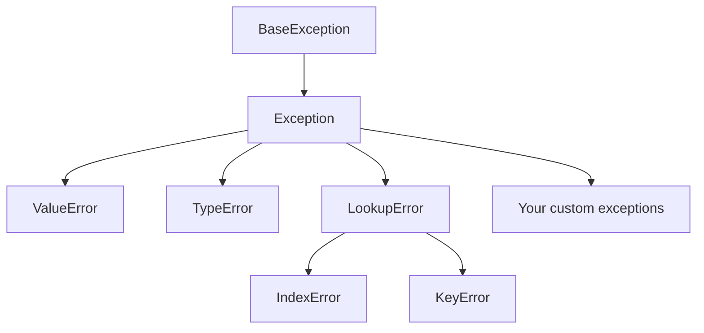

# Exception Handling

!!! abstract "Learning Objectives"
    By the end of this lesson, you can:

    - Read a traceback and identify the exception type
    - Handle errors with `try`, `except`, `else` and `finally`
    - Catch specific exceptions instead of hiding all errors
    - Raise exceptions with `raise` and create custom exception classes
    - Validate user input in a retry loop

**Prerequisites:** [Classes & Objects](01-classes-and-objects.md) and [Inheritance](02-inheritance-and-polymorphism.md)

## Errors and Exceptions

There are two kinds of errors in Python.

**Syntax errors** happen **before** the program runs, when the code isn't valid Python:

```python
print("Hello"
```

```{ .text .output }
SyntaxError: '(' was never closed
```

You must fix these in the code; they can't be "handled".

**Exceptions** happen **while** the program is running, when something goes wrong with valid code:

```python
marks = [85, 92]
print("Start")
print(marks[5])
print("End")
```

```{ .text .output }
Start
Traceback (most recent call last):
  File "main.py", line 3, in <module>
    print(marks[5])
          ~~~~~^^^
IndexError: list index out of range
```

`End` never printed: an unhandled exception **crashes** the program at that line.

!!! example "Real-life analogy: a car's airbag"
    You don't plan to crash, but if it happens, the airbag deploys and protects you instead of things ending badly. Exception handling is your program's airbag: when something unexpected happens, you catch it and respond safely instead of crashing.

### Reading a traceback

Read it **bottom-up**:

1. **Last line:** the exception type and message (`IndexError: list index out of range`).
2. **Line above:** the exact code that failed.
3. **File and line number:** where to look.

**Common exceptions you've already met**

| Exception | When it happens | Example |
|-----------|-----------------|---------|
| `ValueError` | Right type, wrong value | `int("abc")` |
| `TypeError` | Wrong type for an operation | `"5" + 5` |
| `NameError` | Variable doesn't exist | `print(totl)` |
| `IndexError` | List index out of range | `[1, 2][5]` |
| `KeyError` | Dict key doesn't exist | `{"a": 1}["b"]` |
| `ZeroDivisionError` | Dividing by zero | `10 / 0` |
| `AttributeError` | Object has no such attribute or method | `"hi".push()` |
| `FileNotFoundError` | File doesn't exist | `open("missing.txt")` |
| `ModuleNotFoundError` | Module not installed or misspelt | `import reqests` |

## try and except

Put risky code inside `try`. If an exception happens, Python jumps to `except` instead of crashing.

```python
try:
    age = int("twenty")
    print("Age is", age)
except ValueError:
    print("Please enter age as a number, like 25")

print("Program continues...")
```

```{ .text .output }
Please enter age as a number, like 25
Program continues...
```

The line `print("Age is", age)` was skipped because the exception happened on the line before it.

### A validation loop with user input

```python
while True:
    try:
        age = int(input("Enter your age: "))
        break                                  # valid, so leave the loop
    except ValueError:
        print("That's not a number. Try again.")

print(f"Next year you'll be {age + 1}")
```

```{ .text .output }
Enter your age: abc
That's not a number. Try again.
Enter your age: 25.5
That's not a number. Try again.
Enter your age: 25
Next year you'll be 26
```

This pattern is used in almost every interactive program.

## Handling Specific Exceptions

Different problems need different responses. Use several `except` blocks:

```python
def divide(a, b):
    try:
        return int(a) / int(b)
    except ValueError:
        return "Both values must be numbers"
    except ZeroDivisionError:
        return "Cannot divide by zero"

print(divide("10", "2"))
print(divide("10", "abc"))
print(divide("10", "0"))
```

```{ .text .output }
5.0
Both values must be numbers
Cannot divide by zero
```

Group exceptions that need the same handling in a tuple, and use `as e` to get the error message:

```python
def get_item(data, key):
    try:
        return data[key]
    except (KeyError, IndexError) as e:
        return f"Not found: {e!r}"

print(get_item({"a": 1}, "b"))
print(get_item([10, 20], 5))
```

```{ .text .output }
Not found: KeyError('b')
Not found: IndexError('list index out of range')
```

!!! mistake "Common Mistake: catching everything"
    ```python
    try:
        total = price * quantity
        send_invoice(customr)        # typo!
    except:
        print("Something went wrong")
    ```

    A bare `except:` (or `except Exception:`) also hides **bugs** like the typo above (`NameError`), so you'll never find them. Catch **specific** exceptions you expect and know how to handle. If you must catch everything (for example at the top level of a server), at least log the error details.

## else and finally

The full structure:

```python
try:
    ...         # code that might fail
except ...:
    ...         # runs if that exception happened
else:
    ...         # runs only if NO exception happened
finally:
    ...         # ALWAYS runs: success, failure, even after return
```

```python
def process_payment(amount):
    print(f"Processing ₹{amount}...")
    try:
        if amount <= 0:
            raise ValueError("Amount must be positive")
    except ValueError as e:
        print("Failed:", e)
    else:
        print("Payment successful")
    finally:
        print("Closing payment session\n")

process_payment(1500)
process_payment(-50)
```

```{ .text .output }
Processing ₹1500...
Payment successful
Closing payment session

Processing ₹-50...
Failed: Amount must be positive
Closing payment session

```

| Block | Runs when | Typical use |
|-------|-----------|-------------|
| `try` | Always (until an error) | Risky code |
| `except` | A matching exception occurred | Recover, show a friendly message |
| `else` | No exception occurred | Code that should run only on success |
| `finally` | Always | Clean-up: close files and database connections, release locks |

!!! realworld "In Real Projects"
    Database code always uses this structure: `try` to run queries, `except` to **roll back** the transaction if anything fails (so a payment isn't half-saved), and `finally` to close the connection. In web frameworks, unhandled exceptions become **500 Internal Server Error** responses, so APIs catch expected errors and return clean messages like `404 Not Found` or `400 Bad Request`.

## Raising Exceptions

Use `raise` to signal that something is wrong, typically when input breaks your rules.

```python
def set_age(age):
    if not isinstance(age, int):
        raise TypeError("Age must be an integer")
    if age < 0 or age > 120:
        raise ValueError(f"Invalid age: {age}")
    return age

print(set_age(25))

try:
    set_age(150)
except ValueError as e:
    print("Error:", e)
```

```{ .text .output }
25
Error: Invalid age: 150
```

Raising early with a clear message is much better than letting bad data travel through the program and fail somewhere confusing later.

### Re-raising

Sometimes you want to log an error and still let it propagate:

```python
try:
    int("x")
except ValueError:
    print("Logging: bad input received")
    raise          # re-raise the same exception
```

```{ .text .output }
Logging: bad input received
ValueError: invalid literal for int() with base 10: 'x'
```

## Custom Exceptions

For your own application rules, create custom exceptions by inheriting from `Exception`. They make errors self-explanatory and let callers catch exactly what they need.

```python
class InsufficientBalanceError(Exception):
    """Raised when a withdrawal exceeds the balance."""

class InvalidAmountError(Exception):
    """Raised when an amount is zero or negative."""

class BankAccount:
    def __init__(self, owner, balance=0):
        self.owner = owner
        self.balance = balance

    def withdraw(self, amount):
        if amount <= 0:
            raise InvalidAmountError(f"Amount must be positive, got {amount}")
        if amount > self.balance:
            raise InsufficientBalanceError(
                f"Tried to withdraw ₹{amount}, but balance is ₹{self.balance}"
            )
        self.balance -= amount
        return self.balance

account = BankAccount("Asha", 3000)

for amount in [1000, -5, 9000]:
    try:
        left = account.withdraw(amount)
        print(f"Withdrew ₹{amount}. Left: ₹{left}")
    except InvalidAmountError as e:
        print("Invalid:", e)
    except InsufficientBalanceError as e:
        print("Declined:", e)
```

```{ .text .output }
Withdrew ₹1000. Left: ₹2000
Invalid: Amount must be positive, got -5
Declined: Tried to withdraw ₹9000, but balance is ₹2000
```



Exceptions form a hierarchy: `except LookupError` catches both `IndexError` and `KeyError`. Always inherit custom exceptions from `Exception`, not `BaseException`.

### Logging instead of printing

In real applications, errors are **logged** to files or monitoring tools rather than printed:

```python
import logging

logging.basicConfig(level=logging.INFO, format="%(levelname)s: %(message)s")

try:
    10 / 0
except ZeroDivisionError:
    logging.error("Division failed while calculating the average")
```

```{ .text .output }
ERROR: Division failed while calculating the average
```

`logging.exception("...")` inside an `except` block also records the full traceback.

## Common Mistakes

| Mistake | Problem | Fix |
|---------|---------|-----|
| Bare `except:` | Hides real bugs and even Ctrl+C | Catch specific exceptions |
| `except: pass` | Errors silently disappear | At least log the error |
| Too much code inside `try` | Hard to know what failed | Keep `try` blocks small |
| Wrong order: `except Exception` before `except ValueError` | Specific handler never runs | Put specific exceptions first |
| Using exceptions for normal flow everywhere | Slow, hard-to-read code | Use `if` for expected cases (`dict.get`, `in`) |
| `raise "error"` | `TypeError: exceptions must derive from BaseException` | `raise ValueError("error")` |
| Custom exception inheriting from `BaseException` | Not caught by `except Exception` | Inherit from `Exception` |

## Practice Exercises

**Easy**

1. Ask the user for two numbers and print their division. Handle `ValueError` and `ZeroDivisionError` with friendly messages.
2. Given `courses = ["Python", "Java"]`, ask for an index and print the course. Handle invalid indexes and non-numeric input.
3. Write `safe_int(text, default=0)` that returns `int(text)`, or `default` if conversion fails.

**Medium**

4. Write a loop that keeps asking for a 6-digit PIN code until the user enters exactly 6 digits. Raise and catch a `ValueError` with a clear message for each invalid attempt.
5. Write `get_price(products, name)` that raises a `KeyError` with a helpful message if the product doesn't exist. Demonstrate `try/except/else/finally` around a call to it.
6. Explain the output order of a function with `try`, `except`, `else` and `finally`, each containing a `print`, when (a) no error occurs and (b) an error occurs.

**Challenge**

7. Create custom exceptions `OutOfStockError` and `InvalidQuantityError`. Build an `Inventory` class with `purchase(item, qty)` that raises the right exception (unknown items raise `KeyError`). Write a loop that processes a list of orders, prints a result for each, and counts successful and failed orders.

??? success "Solutions (click to expand)"

    ```python
    # 1
    try:
        a = float(input("a: "))
        b = float(input("b: "))
        print(a / b)
    except ValueError:
        print("Please enter numbers only")
    except ZeroDivisionError:
        print("Cannot divide by zero")

    # 2
    courses = ["Python", "Java"]
    try:
        print(courses[int(input("Index: "))])
    except ValueError:
        print("Index must be a number")
    except IndexError:
        print(f"Choose an index from 0 to {len(courses) - 1}")

    # 3
    def safe_int(text, default=0):
        try:
            return int(text)
        except (ValueError, TypeError):
            return default

    print(safe_int("42"), safe_int("abc"), safe_int(None, -1))   # 42 0 -1

    # 4
    while True:
        try:
            pin = input("PIN code: ").strip()
            if not (pin.isdigit() and len(pin) == 6):
                raise ValueError("PIN code must be exactly 6 digits")
            break
        except ValueError as e:
            print(e)
    print("Saved:", pin)

    # 5
    def get_price(products, name):
        if name not in products:
            raise KeyError(f"No product named {name!r}")
        return products[name]

    products = {"pen": 10, "bag": 800}
    try:
        price = get_price(products, "laptop")
    except KeyError as e:
        print("Error:", e)
    else:
        print("Price:", price)
    finally:
        print("Lookup finished")

    # 6: (a) try → else → finally   (b) try (up to the error) → except → finally

    # 7
    class OutOfStockError(Exception):
        pass

    class InvalidQuantityError(Exception):
        pass

    class Inventory:
        def __init__(self, stock):
            self.stock = stock

        def purchase(self, item, qty):
            if qty <= 0:
                raise InvalidQuantityError(f"Quantity must be positive, got {qty}")
            if item not in self.stock:
                raise KeyError(item)
            if self.stock[item] < qty:
                raise OutOfStockError(f"Only {self.stock[item]} {item}(s) left")
            self.stock[item] -= qty

    inv = Inventory({"pen": 10, "notebook": 2})
    orders = [("pen", 3), ("notebook", 5), ("bag", 1), ("pen", 0)]
    ok = failed = 0
    for item, qty in orders:
        try:
            inv.purchase(item, qty)
        except (OutOfStockError, InvalidQuantityError) as e:
            print(f"{item}: {e}")
            failed += 1
        except KeyError:
            print(f"{item}: unknown product")
            failed += 1
        else:
            print(f"{item}: bought {qty}")
            ok += 1
    print(f"Success: {ok}, Failed: {failed}")     # Success: 1, Failed: 3
    ```

!!! note "Mini Assignment"
    Make your class-based `student_manager` crash-proof: every `input()` must be validated (roll numbers must be integers, marks must be 0–100), adding a duplicate roll number should raise a custom `DuplicateStudentError`, and looking up a missing student should raise `StudentNotFoundError`. The menu loop catches these and shows friendly messages, so the program should never crash, whatever the user types.

## Interview Questions

!!! interview "1. What is the difference between an error and an exception?"
    Syntax errors are detected before execution, when the code is invalid, and must be fixed in the source. Exceptions occur during execution when valid code hits a problem (bad input, missing file, division by zero) and can be caught and handled with `try`/`except`.

!!! interview "2. What is the purpose of `else` and `finally` in a try block?"
    `else` runs only if the `try` block raised no exception; use it for code that should run on success. `finally` always runs, whether there was an exception or not, even after `return`, and is used for clean-up such as closing files or connections.

!!! interview "3. Why is a bare `except:` considered bad practice?"
    It catches every exception, including programming bugs (`NameError`, `TypeError`) and system exits like `KeyboardInterrupt`, which hides problems and makes debugging very hard. Catch specific exceptions instead.

!!! interview "4. How do you create a custom exception?"
    Define a class that inherits from `Exception` (or a more specific built-in exception): `class InsufficientBalanceError(Exception): pass`. Raise it with `raise InsufficientBalanceError("message")`.

!!! interview "5. What is the difference between `raise` and `raise e` / `raise X from e`?"
    A bare `raise` inside `except` re-raises the current exception with its original traceback. `raise NewError(...) from e` raises a new exception while chaining the original as its cause, which is useful for converting low-level errors into domain-specific ones.

!!! interview "Scenario: your app sometimes leaves database connections open after an error, and eventually the database refuses new connections. How do you fix it?"
    Close connections in a `finally` block (or use a context manager, `with connection:`), so they're released whether the query succeeds or raises an exception. Also roll back the transaction in the `except` block.

## Summary

| Concept | Remember |
|---------|----------|
| Syntax error vs exception | Before running vs while running |
| Traceback | Read bottom-up: type and message, then line |
| `try` / `except` | Run risky code / handle a specific exception |
| `as e` | Access the exception message |
| `else` | Runs only if no exception occurred |
| `finally` | Always runs: clean-up |
| `raise` | Signal an error: `raise ValueError("...")` |
| Custom exception | `class MyError(Exception): pass` |
| Best practice | Catch specific exceptions, keep `try` small, log errors |

**Next lesson:** [File Handling](04-file-handling.md), reading and writing text, CSV and JSON files.
