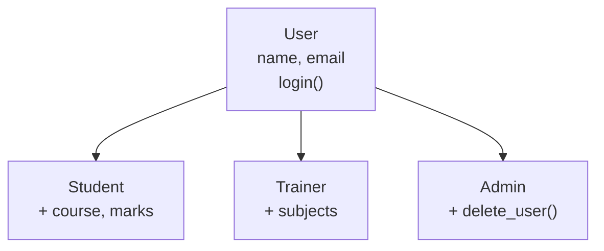
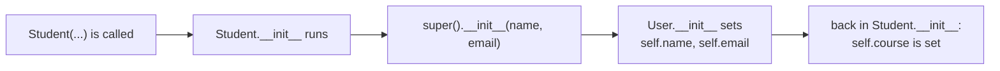

# Inheritance

!!! abstract "Learning Objectives"
    By the end of this lesson, you can:

    - Create child classes that inherit from a parent class
    - Extend a parent's `__init__` with `super()`
    - Override methods to change or extend behaviour in a child class
    - Name the types of inheritance and recognise each from its shape
    - Explain how Python decides which method to run (the MRO)

**Prerequisites:** [Classes & Objects](01-classes-and-objects.md) and [Class Members & Encapsulation](02-class-members-and-encapsulation.md)

!!! info "How this lesson is organised"
    **Part A** (sections 1 to 3) covers reuse: parents, children, `super()` and overriding.
    **Part B** (sections 4 and 5) covers the shapes inheritance can take and how Python resolves method names.
    Inheritance is the second of the **four pillars of OOP**.

## What is Inheritance?

Inheritance lets a new class **reuse** everything from an existing class and add or change only what's different.

- The existing class is the **parent** (also called **base class** or **superclass**).
- The new class is the **child** (also called **derived class** or **subclass**).

!!! example "Real-life analogy: family traits"
    Children inherit features from their parents (eye colour, surname) but also have their own unique traits. A child class gets all of the parent's attributes and methods for free, and can add new ones or change existing ones.

Without inheritance, similar classes repeat the same code:

```python
class Student:
    def __init__(self, name: str, email: str) -> None:
        self.name = name
        self.email = email

    def login(self) -> str:
        return f"{self.name} logged in"

class Trainer:
    def __init__(self, name: str, email: str) -> None:
        self.name = name                 # repeated
        self.email = email               # repeated

    def login(self) -> str:              # repeated
        return f"{self.name} logged in"
```

If the login rule changes, you must remember to change it in every class. With inheritance, the shared parts live in **one** parent class:

```python
class User:
    def __init__(self, name: str, email: str) -> None:
        self.name = name
        self.email = email

    def login(self) -> str:
        return f"{self.name} logged in"

class Student(User):        # Student inherits from User
    pass

class Trainer(User):
    pass

s = Student("Asha", "asha@ksr.com")
t = Trainer("Kiran", "kiran@ksr.com")

print(s.login())
print(t.login())
print(isinstance(s, Student), isinstance(s, User), isinstance(s, Trainer))
print(issubclass(Trainer, User))
```

```{ .text .output }
Asha logged in
Kiran logged in
True True False
True
```

- `class Student(User):` means "**Student is a User**". The parent goes in the brackets.
- `Student` has no code of its own, yet `s.login()` works. It was inherited.
- `isinstance(s, User)` is `True`: a student object counts as a `User` too.

Inheritance models **"is-a"** relationships: a `Student` *is a* `User`, a `Car` *is a* `Vehicle`, a `SavingsAccount` *is a* `BankAccount`. If "is a" sounds wrong when you say it aloud, inheritance is probably the wrong tool.



## Extending `__init__` with `super()`

Child classes usually need extra attributes. A student has a course; a plain user doesn't. Use `super()` to call the parent's `__init__` so you don't repeat its code:

```python
class User:
    def __init__(self, name: str, email: str) -> None:
        self.name = name
        self.email = email

    def login(self) -> str:
        return f"{self.name} logged in"

class Student(User):
    def __init__(self, name: str, email: str, course: str) -> None:
        super().__init__(name, email)     # let the parent set name and email
        self.course = course              # then add the child's own data

    def enroll_message(self) -> str:
        return f"{self.name} is enrolled in {self.course}"

s = Student("Asha", "asha@ksr.com", "Full Stack Python")
print(s.login())              # inherited from User
print(s.enroll_message())     # Student's own
```

```{ .text .output }
Asha logged in
Asha is enrolled in Full Stack Python
```

What happens on `Student("Asha", "asha@ksr.com", "Full Stack Python")`:



`self` is the **same object** the whole way through. The parent fills in its part, then the child adds its own.

!!! mistake "Common Mistake: forgetting `super().__init__()`"
    ```python
    class User:
        def __init__(self, name: str, email: str) -> None:
            self.name = name
            self.email = email

    class Student(User):
        def __init__(self, name: str, email: str, course: str) -> None:
            self.course = course          # parent's __init__ never runs

    s = Student("Asha", "asha@ksr.com", "Python")
    print(s.name)
    ```

    ```{ .text .output }
    AttributeError: 'Student' object has no attribute 'name'
    ```

    When a child defines its own `__init__`, the parent's no longer runs automatically. Call `super().__init__(...)` first.

## Method Overriding

A child can **override** a parent method by defining a method with the **same name**. The child's version is used for child objects.

```python
class User:
    def __init__(self, name: str) -> None:
        self.name = name

    def dashboard(self) -> str:
        return f"Welcome {self.name}"

class Student(User):
    def dashboard(self) -> str:           # replaces the parent's version
        return f"Welcome {self.name}: your courses and assignments"

class Admin(User):
    def dashboard(self) -> str:           # extends the parent's version
        base = super().dashboard()
        return base + " | Admin panel: users, payments, reports"

print(User("Guest").dashboard())
print(Student("Asha").dashboard())
print(Admin("Ravi").dashboard())
```

```{ .text .output }
Welcome Guest
Welcome Asha: your courses and assignments
Welcome Ravi | Admin panel: users, payments, reports
```

Overriding gives you two choices:

| Choice | How | Example above |
|--------|-----|---------------|
| **Replace** the parent's behaviour | Define the method and don't call `super()` | `Student.dashboard()` |
| **Extend** the parent's behaviour | Call `super().method()` and add to the result | `Admin.dashboard()` |

When you call `obj.dashboard()`, Python looks for `dashboard` on the object's own class first. If it isn't there, it looks in the parent, then the parent's parent, and so on.

!!! realworld "In Real Projects"
    Django is built on inheritance. Your models inherit from `models.Model` (getting `save()`, `delete()` and querying for free). Class-based views inherit from `ListView` or `CreateView`, and you override only methods like `get_queryset()`. In FastAPI, request schemas inherit from Pydantic's `BaseModel`.

??? question "Checkpoint A: predict the output before you expand this"
    ```python
    class Animal:
        def speak(self) -> str:
            return "..."

        def intro(self) -> str:
            return f"I say {self.speak()}"

    class Dog(Animal):
        def speak(self) -> str:
            return "Woof"

    print(Animal().intro())
    print(Dog().intro())
    ```

    **Answer:**

    ```{ .text .output }
    I say ...
    I say Woof
    ```

    `Dog` doesn't define `intro()`, so the parent's version runs. But inside it, `self` is a `Dog`, so `self.speak()` finds `Dog.speak()` first. A parent method can call a method that the child has overridden. Remember this: it's the heart of polymorphism in the next lesson.

!!! info "End of Part A"
    You can now build a child class, extend its `__init__` and override methods. This is a good place to pause in class.

## Types of Inheritance

| Type | Shape | Example |
|------|-------|---------|
| **Single** | One parent → one child | `Student(User)` |
| **Multilevel** | Grandparent → parent → child | `User → Employee → Manager` |
| **Hierarchical** | One parent → many children | `User → Student, Trainer, Admin` |
| **Multiple** | Many parents → one child | `class SmartPhone(Camera, Phone)` |
| **Hybrid** | A mix of the above | Hierarchical + multiple in one design |

You've already used single and hierarchical inheritance in this lesson. Here are the other two.

### Multilevel

```python
class User:
    def __init__(self, name: str) -> None:
        self.name = name

class Employee(User):
    def __init__(self, name: str, salary: int) -> None:
        super().__init__(name)
        self.salary = salary

class Manager(Employee):
    def __init__(self, name: str, salary: int, team: list[str]) -> None:
        super().__init__(name, salary)
        self.team = team

m = Manager("Meena", 120000, ["Asha", "Ravi"])
print(m.name, m.salary, m.team)
print(isinstance(m, User))
```

```{ .text .output }
Meena 120000 ['Asha', 'Ravi']
True
```

Each level calls `super().__init__()` with what **its own parent** needs. `Manager` passes `name` and `salary` to `Employee`, and `Employee` passes `name` to `User`.

### Multiple

```python
class Camera:
    def take_photo(self) -> str:
        return "Click!"

class Phone:
    def call(self, number: str) -> str:
        return f"Calling {number}"

class SmartPhone(Camera, Phone):
    pass

sp = SmartPhone()
print(sp.take_photo())
print(sp.call("98765 43210"))
```

```{ .text .output }
Click!
Calling 98765 43210
```

A `SmartPhone` gets the methods of both parents. That's simple while the parents have different method names. The interesting question is what happens when they don't.

## The Method Resolution Order (MRO)

Suppose both parents define a method with the **same name**:

```python
class Camera:
    def start(self) -> str:
        return "Camera ready"

class Phone:
    def start(self) -> str:
        return "Phone ready"

class SmartPhone(Camera, Phone):
    pass

class OfficePhone(Phone, Camera):
    pass

print(SmartPhone().start())
print(OfficePhone().start())
print([cls.__name__ for cls in SmartPhone.__mro__])
```

```{ .text .output }
Camera ready
Phone ready
['SmartPhone', 'Camera', 'Phone', 'object']
```

Python searches classes in a fixed order called the **Method Resolution Order (MRO)**: the class itself first, then its parents **from left to right** as written in the brackets. The first match wins.

- `SmartPhone(Camera, Phone)` finds `Camera.start()` first.
- `OfficePhone(Phone, Camera)` finds `Phone.start()` first.
- `ClassName.__mro__` shows the exact order. Every class ends at `object`, the parent of all classes in Python.

??? note "Going deeper: the diamond problem (optional)"
    When two parents share the same grandparent, the shape is a diamond:

    ```mermaid
    flowchart TD
      D["Device"] --> C["Camera"]
      D --> P["Phone"]
      C --> S["SmartPhone"]
      P --> S
    ```

    ```python
    class Device:
        def info(self) -> str:
            return "Device"

    class Camera(Device):
        def info(self) -> str:
            return "Camera > " + super().info()

    class Phone(Device):
        def info(self) -> str:
            return "Phone > " + super().info()

    class SmartPhone(Camera, Phone):
        def info(self) -> str:
            return "SmartPhone > " + super().info()

    print(SmartPhone().info())
    print([cls.__name__ for cls in SmartPhone.__mro__])
    ```

    ```{ .text .output }
    SmartPhone > Camera > Phone > Device
    ['SmartPhone', 'Camera', 'Phone', 'Device', 'object']
    ```

    Two things to notice. `Device.info()` runs only **once**, even though two parents inherit from it. And `super()` inside `Camera` calls `Phone`, which is not `Camera`'s parent. `super()` really means "the **next class in the MRO**", not "my parent". For single inheritance the two are the same, which is why you could think of it as "the parent" until now.

!!! tip "Use multiple inheritance sparingly"
    It's powerful but can get confusing. In practice it's mostly used for small "mixin" classes that add one feature, such as Django's `LoginRequiredMixin`.

??? question "Checkpoint B: predict the output before you expand this"
    ```python
    class A:
        def hello(self) -> str:
            return "A"

    class B(A):
        pass

    class C(A):
        def hello(self) -> str:
            return "C"

    class D(B, C):
        pass

    print(D().hello())
    print([cls.__name__ for cls in D.__mro__])
    ```

    **Answer:**

    ```{ .text .output }
    C
    ['D', 'B', 'C', 'A', 'object']
    ```

    Many people expect `A`, reasoning "D → B → B's parent A". But the MRO checks **all the children before the shared parent**: D, then B (no `hello`), then C (found). When in doubt, print `__mro__`.

## Common Mistakes

| Mistake | Error / Result | Fix |
|---------|----------------|-----|
| Child `__init__` without `super().__init__()` | `AttributeError` for parent attributes | Call `super().__init__(...)` |
| Wrong arguments to `super().__init__()` | `TypeError: ... missing 1 required positional argument` | Match the **parent's** parameters |
| Passing `self` to `super().__init__(self, name)` | `TypeError: ... takes 2 positional arguments but 3 were given` | Leave `self` out; Python passes it |
| Overriding with a typo (`dashbord`) | Parent method still runs | Use the exact same name |
| `super.__init__()` (missing `()` after `super`) | `TypeError: descriptor '__init__' of 'super' object needs an argument` | `super().__init__()` |
| Forgetting `return` when extending: `super().dashboard()` alone | Method returns `None` | `return super().dashboard() + ...` |
| Inheriting only to reuse one method | Awkward "is-a" that isn't true | Use composition (next lesson) |

## Practice Exercises

**Easy**

1. Create a parent class `Vehicle` with `brand` and `wheels`, and a method `info()`. Create `Car` and `Bike` child classes and print their info.
2. Add a `fuel_type` attribute to `Car` using `super().__init__()`.
3. Override `info()` in `Bike` so it extends the parent's text with `" (Two-wheeler)"`.

**Medium**

4. Build a multilevel chain `Person → Employee → Developer`, where each level adds one attribute, and print all attributes of a `Developer`.
5. Using the `BankAccount` from the last lesson as the parent, create `SavingsAccount` with a `MIN_BALANCE = 1000` class attribute. Override `withdraw()` so it raises `ValueError` if the withdrawal would take the balance below the minimum, and otherwise lets the parent do the work.
6. Create two classes `Logger` (method `log(message)` that prints `[LOG] message`) and `Saver` (method `save()` that returns `"Saved"`). Create `Document(Logger, Saver)` with a method `publish()` that uses both. Print `Document.__mro__` as a list of names.

**Challenge**

7. Model salaries: `Employee` has `name` and `base_salary` and a method `annual_pay()` returning 12 × base. `Manager` adds `bonus` and extends `annual_pay()` with `super()`. `Director` inherits from `Manager`, adds `stock_value` and extends it again. Add `__str__` once, in `Employee`, that prints the class name, the person's name and the annual pay, and check that it works for all three without being overridden.

??? success "Solution 1, 2 and 3: Vehicle"

    ```python
    class Vehicle:
        def __init__(self, brand: str, wheels: int) -> None:
            self.brand = brand
            self.wheels = wheels

        def info(self) -> str:
            return f"{self.brand} with {self.wheels} wheels"

    class Car(Vehicle):
        def __init__(self, brand: str, fuel_type: str) -> None:
            super().__init__(brand, 4)
            self.fuel_type = fuel_type

    class Bike(Vehicle):
        def __init__(self, brand: str) -> None:
            super().__init__(brand, 2)

        def info(self) -> str:
            return super().info() + " (Two-wheeler)"

    car = Car("Tata", "EV")
    print(car.info(), "|", car.fuel_type)       # Tata with 4 wheels | EV
    print(Bike("Royal Enfield").info())         # Royal Enfield with 2 wheels (Two-wheeler)
    ```

??? success "Solution 4: Person → Employee → Developer"

    ```python
    class Person:
        def __init__(self, name: str) -> None:
            self.name = name

    class Employee(Person):
        def __init__(self, name: str, emp_id: str) -> None:
            super().__init__(name)
            self.emp_id = emp_id

    class Developer(Employee):
        def __init__(self, name: str, emp_id: str, language: str) -> None:
            super().__init__(name, emp_id)
            self.language = language

    d = Developer("Ravi", "E102", "Python")
    print(vars(d))      # {'name': 'Ravi', 'emp_id': 'E102', 'language': 'Python'}
    ```

    `vars(obj)` returns an object's instance attributes as a dictionary. It's handy for a quick look.

??? success "Solution 5: SavingsAccount"

    ```python
    class BankAccount:
        def __init__(self, owner: str, balance: float = 0) -> None:
            self.owner = owner
            self._balance = balance

        @property
        def balance(self) -> float:
            return self._balance

        def withdraw(self, amount: float) -> None:
            if amount <= 0:
                raise ValueError("Withdrawal must be positive")
            if amount > self._balance:
                raise ValueError("Insufficient balance")
            self._balance -= amount

    class SavingsAccount(BankAccount):
        MIN_BALANCE = 1000

        def withdraw(self, amount: float) -> None:
            if self.balance - amount < SavingsAccount.MIN_BALANCE:
                raise ValueError(f"Balance cannot go below ₹{SavingsAccount.MIN_BALANCE}")
            super().withdraw(amount)        # the parent does the rest

    acc = SavingsAccount("Asha", 5000)
    acc.withdraw(3000)
    print(acc.balance)                      # 2000
    acc.withdraw(1500)                      # ValueError: Balance cannot go below ₹1000
    ```

??? success "Solution 6: Logger and Saver"

    ```python
    class Logger:
        def log(self, message: str) -> None:
            print(f"[LOG] {message}")

    class Saver:
        def save(self) -> str:
            return "Saved"

    class Document(Logger, Saver):
        def publish(self) -> None:
            self.log("Publishing document")
            print(self.save())

    Document().publish()
    # [LOG] Publishing document
    # Saved
    print([cls.__name__ for cls in Document.__mro__])
    # ['Document', 'Logger', 'Saver', 'object']
    ```

??? success "Solution 7: Employee → Manager → Director"

    ```python
    class Employee:
        def __init__(self, name: str, base_salary: int) -> None:
            self.name = name
            self.base_salary = base_salary

        def annual_pay(self) -> int:
            return self.base_salary * 12

        def __str__(self) -> str:
            return f"{type(self).__name__} {self.name}: ₹{self.annual_pay():,}"

    class Manager(Employee):
        def __init__(self, name: str, base_salary: int, bonus: int) -> None:
            super().__init__(name, base_salary)
            self.bonus = bonus

        def annual_pay(self) -> int:
            return super().annual_pay() + self.bonus

    class Director(Manager):
        def __init__(self, name: str, base_salary: int, bonus: int, stock_value: int) -> None:
            super().__init__(name, base_salary, bonus)
            self.stock_value = stock_value

        def annual_pay(self) -> int:
            return super().annual_pay() + self.stock_value

    for person in [Employee("Asha", 50000), Manager("Ravi", 90000, 150000),
                   Director("Meena", 200000, 500000, 1000000)]:
        print(person)
    # Employee Asha: ₹600,000
    # Manager Ravi: ₹1,230,000
    # Director Meena: ₹3,900,000
    ```

    `__str__` is written once in `Employee`, but `self.annual_pay()` runs the version that belongs to each object's own class. `type(self).__name__` gives the name of that class.

!!! note "Mini Assignment"
    Extend your class-based `student_manager`: create a base `Person` class (name, email, a `describe()` method) and two children, `Student` (adds roll number and marks) and `Trainer` (adds subjects). Both children must call `super().__init__()` and override `describe()` by extending the parent's text. You'll group them into a `Batch` in the next lesson.

## Interview Questions

!!! interview "1. What is inheritance and why is it useful?"
    A mechanism by which a child class acquires the attributes and methods of a parent class. It promotes code reuse, models "is-a" relationships and lets you extend or customise behaviour without modifying the parent.

!!! interview "2. What does `super()` do?"
    It returns a proxy to the next class in the MRO (the parent, in single inheritance), so you can call parent methods: most commonly `super().__init__(...)` to reuse the parent's initialisation, or `super().method()` to extend an overridden method.

!!! interview "3. What is method overriding? Does Python support method overloading?"
    Overriding means a child redefines a parent method with the same name. Python doesn't support classic overloading (several methods with the same name but different parameters); the last definition wins. The same effect is achieved with default arguments, `*args` and `**kwargs`.

!!! interview "4. What types of inheritance does Python support?"
    Single (one parent, one child), multilevel (a chain), hierarchical (one parent, many children), multiple (many parents, one child) and hybrid (a combination).

!!! interview "5. What is MRO?"
    The Method Resolution Order: the order in which Python searches classes for a method or attribute when there is inheritance, especially multiple inheritance. It uses the C3 linearisation algorithm and can be inspected with `ClassName.__mro__` or `ClassName.mro()`.

!!! interview "6. What is the diamond problem and how does Python handle it?"
    When a class inherits from two classes that share a common ancestor, it's unclear which path a method call should take and whether the ancestor runs twice. Python's MRO puts every class in one fixed order with each class appearing once, and `super()` follows that order, so the shared ancestor's method runs exactly once.

!!! interview "Scenario: a child class object raises `AttributeError: 'Manager' object has no attribute 'salary'`, but `salary` is set in the parent. Why?"
    The child defines its own `__init__` and doesn't call `super().__init__(...)`, so the parent's initialisation, which sets `salary`, never runs. Add the `super()` call with the correct arguments.

## Summary

| Concept | Remember |
|---------|----------|
| Inheritance | `class Child(Parent):` reuses and extends; models "is-a" |
| `isinstance()` / `issubclass()` | Check an object's / a class's family |
| `super().__init__(...)` | Run the parent's setup before adding your own |
| Overriding | Same method name in the child; replace, or extend with `super().method()` |
| Types | Single, multilevel, hierarchical, multiple, hybrid |
| MRO | Class first, then parents left to right; inspect with `__mro__` |
| `super()` | Really "the next class in the MRO" |
| Mixins | The main sensible use of multiple inheritance |

**Next lesson:** [Polymorphism, Abstraction & Composition](04-polymorphism-abstraction-composition.md), one interface with many behaviours.
