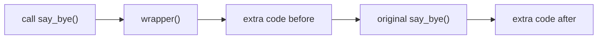

# Decorators & Generators

!!! abstract "Learning Objectives"
    By the end of this lesson, you can:

    - Explain inner functions and closures
    - Write decorators that add behaviour to any function
    - Use `functools.wraps` and write decorators that take arguments
    - Explain iterators and the iteration protocol
    - Write generators with `yield` and chain them into memory-efficient pipelines

**Prerequisites:** [Lambda, Map & Filter](../functions/03-lambda-map-filter.md) (functions as values) and [Classes & Objects](01-classes-and-objects.md)

## Functions Inside Functions and Closures

You already know functions are values: you can store them and pass them around. A function can also be **defined inside** another function, and even **returned** from it.

```python
def make_greeting(greeting):
    def greet(name):                     # inner function
        return f"{greeting}, {name}!"
    return greet                         # return the function itself

say_hello = make_greeting("Hello")
say_namaste = make_greeting("Namaste")

print(say_hello("Asha"))
print(say_namaste("Ravi"))
```

```{ .text .output }
Hello, Asha!
Namaste, Ravi!
```

Notice that `greet` still remembers `greeting` **after** `make_greeting` has finished. An inner function that remembers variables from its enclosing function is called a **closure**.

```python
def make_multiplier(n):
    def multiply(x):
        return x * n
    return multiply

double = make_multiplier(2)
triple = make_multiplier(3)
print(double(10), triple(10))
```

```{ .text .output }
20 30
```

Closures are the building block of decorators.

## What is a Decorator?

A **decorator** is a function that **takes a function, adds some behaviour around it, and returns a new function**, without changing the original function's code.

!!! example "Real-life analogy: gift wrapping"
    A gift (the function) stays exactly the same, but wrapping paper (the decorator) is added around it. You can wrap any gift with the same paper, and you can add several layers of wrapping.

```python
def announce(func):
    def wrapper():
        print("Before the function runs")
        func()
        print("After the function runs")
    return wrapper

def say_hi():
    print("Hi!")

say_hi = announce(say_hi)      # wrap it manually
say_hi()
```

```{ .text .output }
Before the function runs
Hi!
After the function runs
```

### The `@` syntax

Python has a shortcut for `say_hi = announce(say_hi)`: put `@announce` above the definition.

```python
@announce
def say_bye():
    print("Bye!")

say_bye()
```

```{ .text .output }
Before the function runs
Bye!
After the function runs
```



## Writing Useful Decorators

Real functions take arguments and return values. A general-purpose decorator accepts `*args, **kwargs` and returns the result:

```python
import time
from functools import wraps

def timer(func):
    @wraps(func)
    def wrapper(*args, **kwargs):
        start = time.perf_counter()
        result = func(*args, **kwargs)          # call the original
        elapsed = time.perf_counter() - start
        print(f"{func.__name__} took {elapsed:.4f}s")
        return result                           # pass the result back
    return wrapper

@timer
def total_marks(marks):
    return sum(marks)

print(total_marks([85, 92, 78]))
```

```{ .text .output }
total_marks took 0.0000s
255
```

(Your timing may differ slightly.)

!!! tip "Always use `@wraps(func)`"
    Without `@wraps`, the decorated function loses its name and docstring: `total_marks.__name__` would become `"wrapper"`. That breaks debugging, logging and frameworks that rely on function names. `functools.wraps` copies them across.

### A logging decorator

```python
from functools import wraps

def log_call(func):
    @wraps(func)
    def wrapper(*args, **kwargs):
        print(f"Calling {func.__name__} with args={args} kwargs={kwargs}")
        result = func(*args, **kwargs)
        print(f"{func.__name__} returned {result!r}")
        return result
    return wrapper

@log_call
def apply_discount(price, percent=10):
    return price * (100 - percent) / 100

apply_discount(2000, percent=25)
```

```{ .text .output }
Calling apply_discount with args=(2000,) kwargs={'percent': 25}
apply_discount returned 1500.0
```

### An access-control decorator

```python
from functools import wraps

def admin_only(func):
    @wraps(func)
    def wrapper(user, *args, **kwargs):
        if user.get("role") != "admin":
            return f"Access denied for {user['name']}"
        return func(user, *args, **kwargs)
    return wrapper

@admin_only
def delete_course(user, course):
    return f"{course} deleted by {user['name']}"

print(delete_course({"name": "Ravi", "role": "admin"}, "Old Batch"))
print(delete_course({"name": "Asha", "role": "student"}, "Old Batch"))
```

```{ .text .output }
Old Batch deleted by Ravi
Access denied for Asha
```

!!! realworld "In Real Projects"
    Decorators are everywhere in web frameworks:

    - **FastAPI:** `@app.get("/products")` registers a function as an API endpoint.
    - **Django:** `@login_required` blocks anonymous users from a view; `@admin.register(Product)` adds a model to the admin panel.
    - **Python itself:** `@property`, `@classmethod`, `@staticmethod`, `@functools.cache`.

    Once you understand decorators, these stop looking like magic.

## Decorators with Arguments

To configure a decorator, like `@retry(times=3)`, add **one more** outer function that receives the arguments and returns the actual decorator:

```python
from functools import wraps

def repeat(times):
    def decorator(func):
        @wraps(func)
        def wrapper(*args, **kwargs):
            for _ in range(times):
                result = func(*args, **kwargs)
            return result
        return wrapper
    return decorator

@repeat(times=3)
def cheer(name):
    print(f"Go {name}!")

cheer("Team KSR")
```

```{ .text .output }
Go Team KSR!
Go Team KSR!
Go Team KSR!
```

| Decorator style | Layers | Example |
|-----------------|--------|---------|
| Without arguments | decorator → wrapper | `@timer` |
| With arguments | factory → decorator → wrapper | `@repeat(times=3)`, `@app.get("/")` |

### Stacking decorators and built-in caching

Decorators can be stacked; the one **closest** to the function is applied first.

```python
from functools import cache

@cache                        # remembers results of previous calls
def fibonacci(n):
    if n < 2:
        return n
    return fibonacci(n - 1) + fibonacci(n - 2)

print(fibonacci(80))
```

```{ .text .output }
23416728348467685
```

Without `@cache`, `fibonacci(80)` would take far too long to finish because it recalculates the same values millions of times. With it, the result is instant. This technique is called **memoisation**.

## Iterators

Before generators, you need to understand what `for` really does.

An **iterable** is anything you can loop over (list, string, dict, file). An **iterator** is an object that gives you the **next item** each time you ask, and remembers where it is.

```python
courses = ["Python", "SQL", "React"]
it = iter(courses)       # get an iterator from the iterable

print(next(it))
print(next(it))
print(next(it))
print(next(it))
```

```{ .text .output }
Python
SQL
React
StopIteration
```

A `for` loop does exactly this behind the scenes: it calls `iter()` once, then `next()` repeatedly until it gets `StopIteration`.

## Generators

Writing iterator classes by hand is tedious. A **generator** is a function that produces values **one at a time** using `yield` instead of `return`.

```python
def countdown(n):
    while n > 0:
        yield n          # pause here and hand out n
        n -= 1

for number in countdown(3):
    print(number)
```

```{ .text .output }
3
2
1
```

### How `yield` works

- Calling `countdown(3)` doesn't run the body; it returns a **generator object**.
- Each `next()` runs the code until the next `yield`, hands out that value, and **pauses**, keeping all local variables.
- When the function ends, the generator raises `StopIteration` and the loop stops.

```python
def steps():
    print("Step 1")
    yield "A"
    print("Step 2")
    yield "B"
    print("Done")

g = steps()
print(next(g))
print(next(g))
```

```{ .text .output }
Step 1
A
Step 2
B
```

| `return` | `yield` |
|----------|---------|
| Ends the function, gives back one value | Pauses the function, gives back one value at a time |
| All results built in memory first | Values produced on demand (lazy) |

!!! example "Real-life analogy: a chef vs a buffet"
    A normal function is like cooking **all** the dishes before guests arrive: lots of space and time up front. A generator is like a chef cooking **one plate at a time when someone asks**: nothing is wasted, and the first plate arrives immediately.

### Why generators matter: memory

```python
import sys

def squares_list(n):
    return [i * i for i in range(n)]

def squares_gen(n):
    for i in range(n):
        yield i * i

print(sys.getsizeof(squares_list(1_000_000)) > 1_000_000)
print(sys.getsizeof(squares_gen(1_000_000)) < 500)
print(sum(squares_gen(1_000_000)))
```

```{ .text .output }
True
True
333332833333500000
```

The list holds a million numbers in memory at once. The generator holds almost nothing, yet `sum()` still gets every value.

### Infinite generators

Because values are produced on demand, a generator can even be **endless**:

```python
def order_ids(prefix="ORD"):
    number = 1001
    while True:
        yield f"{prefix}{number}"
        number += 1

ids = order_ids()
print(next(ids), next(ids), next(ids))
```

```{ .text .output }
ORD1001 ORD1002 ORD1003
```

## Generator Pipelines

Generators can feed into each other, so data flows through processing steps **one item at a time**, like an assembly line. Here's a pipeline that reads a log file, keeps only errors and extracts their messages:

```python
def read_lines(lines):
    for line in lines:
        yield line.strip()

def only_errors(lines):
    for line in lines:
        if line.startswith("ERROR"):
            yield line

def messages(lines):
    for line in lines:
        yield line.split(":", 1)[1].strip()

log = [
    "INFO: Server started",
    "ERROR: Database connection failed",
    "INFO: User Asha logged in",
    "ERROR: Payment gateway timeout",
]

pipeline = messages(only_errors(read_lines(log)))
for msg in pipeline:
    print(msg)
```

```{ .text .output }
Database connection failed
Payment gateway timeout
```

Replace the `log` list with `open("server.log")` and this pipeline processes a file of any size using almost no memory.

!!! realworld "In Real Projects"
    Generators are used to stream large CSV exports to users, process millions of database rows in batches, read huge log files, and stream AI responses token by token. FastAPI's `StreamingResponse` takes a generator, so a chat assistant's answer appears word by word instead of all at once.

## Common Mistakes

| Mistake | Problem | Fix |
|---------|---------|-----|
| Wrapper doesn't `return` the result | Decorated function returns `None` | `return func(*args, **kwargs)` |
| Wrapper without `*args, **kwargs` | `TypeError` when the function takes arguments | `def wrapper(*args, **kwargs):` |
| Missing `@wraps(func)` | Name and docstring lost (`wrapper`) | Add `@functools.wraps(func)` |
| `@repeat` without parentheses for a decorator that takes arguments | Function gets passed as `times` | Use `@repeat(times=3)` |
| Reusing an exhausted generator | Second loop gives nothing | Call the generator function again |
| `len(gen)` or `gen[0]` | `TypeError` | Generators have no length or index; convert with `list()` if needed |
| Using `return value` inside a generator to send data | Value isn't yielded | Use `yield value` |

## Practice Exercises

**Easy**

1. Write a decorator `shout` that converts a function's string result to upper case.
2. Write a generator `even_numbers(limit)` that yields even numbers up to `limit`.
3. Use `iter()` and `next()` manually on the string `"KSR"`.

**Medium**

4. Write a decorator `validate_positive` that raises `ValueError` if any numeric argument passed to the function is negative.
5. Write a decorator factory `retry(times)` that calls a function again if it raises an exception, up to `times` attempts, then re-raises the last error.
6. Write a generator `read_in_chunks(items, size)` that yields lists of `size` items at a time (useful for batch processing).

**Challenge**

7. Write a decorator `count_calls` that tracks how many times a function has been called (store the count as an attribute on the wrapper, `wrapper.calls`). Then build a generator pipeline over a list of order dicts: yield only paid orders → yield their amounts with 18% GST added → and use `sum()` to get the total. Decorate the final total function with both `@count_calls` and `@timer`.

??? success "Solutions (click to expand)"

    ```python
    import time
    from functools import wraps

    # 1
    def shout(func):
        @wraps(func)
        def wrapper(*args, **kwargs):
            return func(*args, **kwargs).upper()
        return wrapper

    @shout
    def welcome(name):
        return f"welcome {name}"

    print(welcome("asha"))                      # WELCOME ASHA

    # 2
    def even_numbers(limit):
        for n in range(0, limit + 1, 2):
            yield n

    print(list(even_numbers(10)))               # [0, 2, 4, 6, 8, 10]

    # 3
    it = iter("KSR")
    print(next(it), next(it), next(it))         # K S R

    # 4
    def validate_positive(func):
        @wraps(func)
        def wrapper(*args, **kwargs):
            for value in list(args) + list(kwargs.values()):
                if isinstance(value, (int, float)) and value < 0:
                    raise ValueError(f"Negative value not allowed: {value}")
            return func(*args, **kwargs)
        return wrapper

    @validate_positive
    def area(length, width):
        return length * width

    print(area(5, 4))                           # 20

    # 5
    def retry(times):
        def decorator(func):
            @wraps(func)
            def wrapper(*args, **kwargs):
                for attempt in range(1, times + 1):
                    try:
                        return func(*args, **kwargs)
                    except Exception as e:
                        print(f"Attempt {attempt} failed: {e}")
                        if attempt == times:
                            raise
            return wrapper
        return decorator

    # 6
    def read_in_chunks(items, size):
        for i in range(0, len(items), size):
            yield items[i:i + size]

    print(list(read_in_chunks([1, 2, 3, 4, 5, 6, 7], 3)))   # [[1, 2, 3], [4, 5, 6], [7]]

    # 7
    def count_calls(func):
        @wraps(func)
        def wrapper(*args, **kwargs):
            wrapper.calls += 1
            return func(*args, **kwargs)
        wrapper.calls = 0
        return wrapper

    def timer(func):
        @wraps(func)
        def wrapper(*args, **kwargs):
            start = time.perf_counter()
            result = func(*args, **kwargs)
            print(f"{func.__name__} took {time.perf_counter() - start:.4f}s")
            return result
        return wrapper

    def paid(orders):
        for o in orders:
            if o["paid"]:
                yield o

    def with_gst(orders):
        for o in orders:
            yield round(o["amount"] * 1.18, 2)

    @count_calls
    @timer
    def total_revenue(orders):
        return round(sum(with_gst(paid(orders))), 2)

    orders = [
        {"id": 1, "amount": 1000, "paid": True},
        {"id": 2, "amount": 500, "paid": False},
        {"id": 3, "amount": 2500, "paid": True},
    ]
    print(total_revenue(orders))                # 4130.0
    print(total_revenue(orders))
    print("Calls:", total_revenue.calls)        # Calls: 2
    ```

!!! note "Mini Assignment"
    Add two decorators to your `student_manager` project: `@log_action`, which appends a line like `2026-10-31 19:05 add_student(101, 'Asha')` to `activity.log` every time a manager method is called, and `@require_valid_roll`, which checks that the roll number argument is a positive integer before the method runs. Also add a generator method `students_below(percent)` that yields students under a threshold, and use it to print a "needs attention" list.

## Interview Questions

!!! interview "1. What is a decorator in Python?"
    A callable that takes a function (or class) and returns a new one that adds behaviour before and/or after the original, without modifying its source. `@decorator` above a definition is shorthand for `func = decorator(func)`. Common uses: logging, timing, authentication, caching and route registration.

!!! interview "2. What is a closure?"
    An inner function that remembers and can use variables from its enclosing function's scope, even after the outer function has returned. Decorators and function factories rely on closures.

!!! interview "3. Why use `functools.wraps`?"
    It copies the original function's metadata (`__name__`, `__doc__`, `__module__` and more) onto the wrapper. Without it, the decorated function looks like `wrapper`, which breaks debugging, logging, documentation tools and frameworks that inspect function names.

!!! interview "4. What is the difference between an iterator and a generator?"
    An iterator is any object implementing `__iter__` and `__next__`. A generator is a convenient way to create an iterator: a function using `yield` (or a generator expression). Every generator is an iterator, but writing one is much simpler than writing an iterator class.

!!! interview "5. What is the difference between `yield` and `return`?"
    `return` ends the function and sends back one value. `yield` produces a value and **pauses** the function, preserving its state, so it can resume to produce the next value. Functions with `yield` become generators and produce values lazily.

!!! interview "Scenario: a report endpoint builds a list of 5 million rows and the server runs out of memory. How would you redesign it?"
    Use a generator that fetches and yields rows in batches (or one at a time) and stream the response (for example with FastAPI's `StreamingResponse` writing CSV lines). Memory then stays constant regardless of the number of rows.

## Summary

| Concept | Remember |
|---------|----------|
| Closure | Inner function that remembers outer variables |
| Decorator | `@deco` = `func = deco(func)`; adds behaviour around a function |
| Wrapper template | `def wrapper(*args, **kwargs): ... return func(*args, **kwargs)` |
| `@wraps(func)` | Keeps the original name and docstring |
| With arguments | Three layers: factory → decorator → wrapper |
| Built-ins | `@property`, `@classmethod`, `@staticmethod`, `@cache` |
| Iterator | `iter()` + `next()` until `StopIteration` |
| Generator | Function with `yield`; lazy, memory-efficient, single use |
| Pipeline | Chain generators: `messages(only_errors(read_lines(f)))` |

**Next lesson:** [Working with JSON & APIs](06-working-with-json-and-apis.md), talking to real web services from Python.
