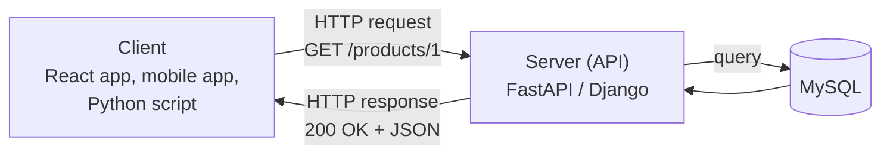

# Working with JSON & APIs

!!! abstract "Learning Objectives"
    By the end of this lesson, you can:

    - Explain what an API is and how a client and server communicate over HTTP
    - Use HTTP methods (GET, POST, PUT, PATCH, DELETE) and understand status codes
    - Convert between JSON and Python, including nested data
    - Call real REST APIs with the `requests` library: query parameters, headers and JSON bodies
    - Handle timeouts and errors, and keep API keys out of your code

**Prerequisites:** [File Handling](04-file-handling.md), [Exception Handling](03-exception-handling.md) and [Virtual Environments & pip](../functions/06-virtual-environments-and-pip.md)

## What is an API?

An **API** (Application Programming Interface) is a way for one program to **ask another program for data or actions**. A **web API** does this over the internet using HTTP, the same protocol your browser uses.

!!! example "Real-life analogy: a restaurant waiter"
    You (the **client**) don't walk into the kitchen. You give your order to the **waiter** (the API), who takes it to the **kitchen** (the server and database) and brings back your food (the response). You only need to know the menu (the API documentation), not how the kitchen works.



Every time you open Swiggy, the app calls APIs: one to get restaurants near you, another to get the menu, another to place the order. **In this course you'll build those APIs with FastAPI and Django**, and call them from React. In this lesson you'll be the **client**, calling APIs from Python.

!!! realworld "In Real Projects"
    Backend developers both **build** APIs and **consume** them: calling a payment gateway (Razorpay, Stripe), sending SMS/OTP (Twilio, MSG91), sending emails, getting maps data, or calling AI models like Claude. All of these are HTTP APIs that speak JSON.

## HTTP Requests and Responses

### An HTTP request has

| Part | Example | Purpose |
|------|---------|---------|
| **Method** | `GET`, `POST` | What action to perform |
| **URL** | `https://api.shop.com/products/42` | Which resource |
| **Query parameters** | `?category=mobile&sort=price` | Filters and options |
| **Headers** | `Authorization: Bearer abc123` | Metadata: auth, content type |
| **Body** | `{"name": "Laptop", "price": 55000}` | Data sent (for POST, PUT, PATCH) |

### HTTP methods (CRUD)

| Method | Meaning | CRUD | Example |
|--------|---------|------|---------|
| `GET` | Read data | **R**ead | Get all products |
| `POST` | Create new data | **C**reate | Register a user |
| `PUT` | Replace data completely | **U**pdate | Replace a product |
| `PATCH` | Update part of the data | **U**pdate | Change only the price |
| `DELETE` | Remove data | **D**elete | Delete an order |

### Status codes

| Range | Meaning | Common codes |
|-------|---------|--------------|
| **2xx** | Success | `200 OK`, `201 Created`, `204 No Content` |
| **3xx** | Redirect | `301 Moved Permanently` |
| **4xx** | Client error (your request is wrong) | `400 Bad Request`, `401 Unauthorized`, `403 Forbidden`, `404 Not Found`, `422 Unprocessable Entity`, `429 Too Many Requests` |
| **5xx** | Server error (their side broke) | `500 Internal Server Error`, `503 Service Unavailable` |

!!! tip "Quick rule"
    **4xx = you made a mistake** (wrong URL, missing data, no permission). **5xx = the server made a mistake.** You'll return these same codes from your own FastAPI and Django APIs.

## JSON in Depth

**JSON** (JavaScript Object Notation) is the language APIs speak. It looks almost like Python dicts and lists, with a few differences:

| JSON | Python |
|------|--------|
| `{"key": "value"}` (object) | `dict` |
| `[1, 2, 3]` (array) | `list` |
| `"text"` (double quotes only) | `str` |
| `42`, `3.14` | `int`, `float` |
| `true` / `false` | `True` / `False` |
| `null` | `None` |

```python
import json

response_text = """
{
  "order_id": "ORD1001",
  "paid": true,
  "coupon": null,
  "customer": {"name": "Asha", "city": "Hyderabad"},
  "items": [
    {"name": "Laptop", "price": 55000, "qty": 1},
    {"name": "Mouse", "price": 799, "qty": 2}
  ]
}
"""

order = json.loads(response_text)          # JSON text → Python dict

print(order["paid"], order["coupon"])
print(order["customer"]["city"])
print(order["items"][1]["name"])

total = sum(item["price"] * item["qty"] for item in order["items"])
print(f"Total: ₹{total:,}")
```

```{ .text .output }
True None
Hyderabad
Mouse
Total: ₹56,598
```

Going the other way, Python → JSON text, for sending to an API:

```python
import json

new_user = {"name": "Ravi", "active": True, "referral": None, "skills": ["Python", "SQL"]}
print(json.dumps(new_user))
```

```{ .text .output }
{"name": "Ravi", "active": true, "referral": null, "skills": ["Python", "SQL"]}
```

!!! mistake "Common Mistake: not everything is JSON-serialisable"
    ```python
    import json
    from datetime import date
    json.dumps({"joined": date(2026, 10, 31)})
    ```

    ```{ .text .output }
    TypeError: Object of type date is not JSON serializable
    ```

    JSON only knows strings, numbers, booleans, null, arrays and objects. Convert dates to strings first: `date(2026, 10, 31).isoformat()` gives `"2026-10-31"`. Sets must become lists.

### Safely navigating nested data

API responses often have **optional** fields. Use `.get()` with defaults so missing keys don't crash your program:

```python
user = {"name": "Kiran", "address": {"city": "Pune"}}

print(user.get("phone", "Not provided"))
print(user.get("address", {}).get("city", "Unknown"))
print(user.get("company", {}).get("name", "Unknown"))
```

```{ .text .output }
Not provided
Pune
Unknown
```

## Calling APIs with requests

`requests` is the most popular Python library for HTTP. Install it in your project's virtual environment:

```bash
pip install requests
```

The examples below use **JSONPlaceholder** (`https://jsonplaceholder.typicode.com`), a free fake REST API made for practice. It returns realistic data and accepts POST/PUT/DELETE without actually saving anything.

### GET: reading data

```python
import requests

response = requests.get("https://jsonplaceholder.typicode.com/users/1", timeout=10)

print(response.status_code)
print(response.headers["Content-Type"])

user = response.json()          # parse the JSON body into a dict
print(user["name"], "-", user["email"])
print(user["address"]["city"])
```

```{ .text .output }
200
application/json; charset=utf-8
Leanne Graham - Sincere@april.biz
Gwenborough
```

| Attribute / method | Gives you |
|--------------------|-----------|
| `response.status_code` | `200`, `404`… |
| `response.ok` | `True` if the status is below 400 |
| `response.json()` | Body parsed into Python dicts/lists |
| `response.text` | Body as a raw string |
| `response.headers` | Response headers (dict-like) |
| `response.raise_for_status()` | Raises `HTTPError` for 4xx/5xx |

### Query parameters

Pass filters as a dict with `params=`; `requests` builds and encodes the URL for you:

```python
import requests

response = requests.get(
    "https://jsonplaceholder.typicode.com/posts",
    params={"userId": 1},
    timeout=10,
)
print(response.url)

posts = response.json()
print(len(posts), "posts")
print(posts[0]["title"])
```

```{ .text .output }
https://jsonplaceholder.typicode.com/posts?userId=1
10 posts
sunt aut facere repellat provident occaecati excepturi optio reprehenderit
```

### POST: sending data

Send a Python dict with `json=`; `requests` converts it to JSON and sets the `Content-Type: application/json` header:

```python
import requests

new_post = {"title": "Learning APIs", "body": "Python requests is easy", "userId": 1}

response = requests.post(
    "https://jsonplaceholder.typicode.com/posts",
    json=new_post,
    timeout=10,
)
print(response.status_code)
print(response.json())
```

```{ .text .output }
201
{'title': 'Learning APIs', 'body': 'Python requests is easy', 'userId': 1, 'id': 101}
```

`201 Created` means the server created the resource and returned it with its new `id`.

### PUT, PATCH and DELETE

```python
import requests

BASE = "https://jsonplaceholder.typicode.com/posts/1"

r = requests.patch(BASE, json={"title": "Updated title"}, timeout=10)
print(r.status_code, r.json()["title"])

r = requests.delete(BASE, timeout=10)
print(r.status_code)
```

```{ .text .output }
200 Updated title
200
```

## Headers, Authentication and API Keys

Most real APIs need you to prove who you are, usually with an **API key** or **token** sent in a header:

```python
import os
import requests

API_KEY = os.environ.get("WEATHER_API_KEY")       # never hard-code secrets

response = requests.get(
    "https://api.example.com/v1/weather",
    params={"city": "Hyderabad"},
    headers={
        "Authorization": f"Bearer {API_KEY}",
        "Accept": "application/json",
    },
    timeout=10,
)
```

!!! warning "Never put API keys in your code"
    Keys committed to GitHub get stolen within minutes by bots that scan public repos, and someone else runs up your bill. Store keys in **environment variables** or a `.env` file that is listed in `.gitignore`, and read them with `os.environ.get(...)`. Your FastAPI and Django projects will follow the same rule.

Set an environment variable for a terminal session:

=== "macOS / Linux"

    ```bash
    export WEATHER_API_KEY="your-key-here"
    ```

=== "Windows (Command Prompt)"

    ```bash
    set WEATHER_API_KEY=your-key-here
    ```

### Using a Session for many requests

A `Session` reuses the connection and shared headers, which is faster when calling the same API repeatedly:

```python
import requests

session = requests.Session()
session.headers.update({"Accept": "application/json"})

for user_id in [1, 2, 3]:
    user = session.get(f"https://jsonplaceholder.typicode.com/users/{user_id}", timeout=10).json()
    print(user["id"], user["name"])
```

```{ .text .output }
1 Leanne Graham
2 Ervin Howell
3 Clementine Bauch
```

## Error Handling and a Reusable API Client

Networks fail. Servers go down. URLs change. Robust code always:

1. sets a **timeout** (without one, a request can hang forever),
2. checks the **status code** (`raise_for_status()`),
3. catches **network errors**.

```python
import requests

def fetch_json(url, **kwargs):
    try:
        response = requests.get(url, timeout=10, **kwargs)
        response.raise_for_status()            # 4xx/5xx → HTTPError
        return response.json()
    except requests.exceptions.Timeout:
        print("The server took too long to respond")
    except requests.exceptions.ConnectionError:
        print("Could not connect. Check your internet connection")
    except requests.exceptions.HTTPError as e:
        print(f"HTTP error: {e.response.status_code}")
    except ValueError:
        print("Response was not valid JSON")
    return None

print(fetch_json("https://jsonplaceholder.typicode.com/users/1")["name"])
print(fetch_json("https://jsonplaceholder.typicode.com/users/9999"))
```

```{ .text .output }
Leanne Graham
HTTP error: 404
None
```

| Exception | Cause |
|-----------|-------|
| `requests.exceptions.Timeout` | No response within the timeout |
| `requests.exceptions.ConnectionError` | No internet, DNS failure, server down |
| `requests.exceptions.HTTPError` | 4xx/5xx status after `raise_for_status()` |
| `ValueError` (`JSONDecodeError`) | Body isn't valid JSON |

### Wrapping an API in a class

In real projects, all calls to one service go through a small client class, which combines everything from this module: classes, exceptions and JSON.

```python
import requests

class PlaceholderClient:
    BASE_URL = "https://jsonplaceholder.typicode.com"

    def __init__(self, timeout=10):
        self.session = requests.Session()
        self.timeout = timeout

    def _get(self, path, **params):
        response = self.session.get(f"{self.BASE_URL}{path}", params=params, timeout=self.timeout)
        response.raise_for_status()
        return response.json()

    def get_user(self, user_id):
        return self._get(f"/users/{user_id}")

    def get_todos(self, user_id, completed=None):
        params = {"userId": user_id}
        if completed is not None:
            params["completed"] = str(completed).lower()
        return self._get("/todos", **params)

client = PlaceholderClient()
user = client.get_user(2)
pending = client.get_todos(2, completed=False)
print(f"{user['name']} has {len(pending)} pending todos")
```

```{ .text .output }
Ervin Howell has 12 pending todos
```

## Common Mistakes

| Mistake | Problem | Fix |
|---------|---------|-----|
| No `timeout=` | Program can hang forever | Always pass `timeout=10` (or similar) |
| Not checking the status code | Treating an error page as data | `response.raise_for_status()` or check `response.ok` |
| `data=my_dict` for a JSON API | Sends form data, server returns 400/422 | Use `json=my_dict` |
| Building URLs by hand: `url + "?q=" + text` | Breaks on spaces and special characters | Use `params={"q": text}` |
| Hard-coding API keys | Keys leak via GitHub | Environment variables / `.env` + `.gitignore` |
| `response.json` without `()` | Gets the method, not the data | `response.json()` |
| `data["key"]` on optional fields | `KeyError` when the field is missing | `data.get("key", default)` |
| `json.dumps()` on dates or sets | `TypeError: Object of type ... is not JSON serializable` | Convert to string or list first |
| Calling an API in a tight loop | `429 Too Many Requests` | Respect rate limits, add delays, cache results |

## Practice Exercises

Use `https://jsonplaceholder.typicode.com` for all exercises.

**Easy**

1. Fetch user 5 and print their name, email, city and company name.
2. Fetch all users (`/users`) and print each user's id and name in a neat table.
3. Fetch post 1 and print its title in upper case and the number of words in its body.

**Medium**

4. Fetch all todos for user 1 (`/todos?userId=1`) and print how many are completed and how many are pending.
5. Create a new post with POST and print the returned id and status code. Then update its title with PATCH.
6. Write `get_user_safe(user_id)` that returns the user dict or `None`, handles timeouts, connection errors and 404s, and test it with ids 1 and 999.

**Challenge**

7. Build a **user report** script: fetch all users, all posts and all todos (three requests), then produce a report showing, for each user, their name, city, number of posts and percentage of completed todos, sorted by completion percentage (highest first). Save the report to `user_report.json` and `user_report.csv`. Use a client class, handle errors, and set timeouts.

??? success "Solutions (click to expand)"

    ```python
    import csv
    import json
    import requests

    BASE = "https://jsonplaceholder.typicode.com"

    # 1
    u = requests.get(f"{BASE}/users/5", timeout=10).json()
    print(u["name"], u["email"], u["address"]["city"], u["company"]["name"])

    # 2
    for u in requests.get(f"{BASE}/users", timeout=10).json():
        print(f"{u['id']:>3}  {u['name']}")

    # 3
    p = requests.get(f"{BASE}/posts/1", timeout=10).json()
    print(p["title"].upper(), "|", len(p["body"].split()), "words")

    # 4
    todos = requests.get(f"{BASE}/todos", params={"userId": 1}, timeout=10).json()
    done = sum(t["completed"] for t in todos)
    print(f"Completed: {done}, Pending: {len(todos) - done}")

    # 5
    r = requests.post(f"{BASE}/posts", json={"title": "Hi", "body": "First post", "userId": 1}, timeout=10)
    print(r.status_code, r.json()["id"])                  # 201 101
    r = requests.patch(f"{BASE}/posts/1", json={"title": "Edited"}, timeout=10)
    print(r.status_code, r.json()["title"])               # 200 Edited

    # 6
    def get_user_safe(user_id):
        try:
            r = requests.get(f"{BASE}/users/{user_id}", timeout=10)
            r.raise_for_status()
            return r.json()
        except requests.exceptions.HTTPError:
            return None
        except (requests.exceptions.Timeout, requests.exceptions.ConnectionError) as e:
            print("Network problem:", type(e).__name__)
            return None

    print(get_user_safe(1)["name"], get_user_safe(999))    # Leanne Graham None

    # 7
    class Client:
        def __init__(self):
            self.session = requests.Session()

        def get(self, path):
            r = self.session.get(f"{BASE}{path}", timeout=10)
            r.raise_for_status()
            return r.json()

    try:
        client = Client()
        users, posts, todos = client.get("/users"), client.get("/posts"), client.get("/todos")
    except requests.exceptions.RequestException as e:
        raise SystemExit(f"Could not fetch data: {e}")

    report = []
    for u in users:
        user_todos = [t for t in todos if t["userId"] == u["id"]]
        completed = sum(t["completed"] for t in user_todos)
        report.append({
            "name": u["name"],
            "city": u["address"]["city"],
            "posts": sum(1 for p in posts if p["userId"] == u["id"]),
            "completion_pct": round(completed / len(user_todos) * 100, 1) if user_todos else 0,
        })
    report.sort(key=lambda r: r["completion_pct"], reverse=True)

    with open("user_report.json", "w", encoding="utf-8") as f:
        json.dump(report, f, indent=2)
    with open("user_report.csv", "w", encoding="utf-8", newline="") as f:
        writer = csv.DictWriter(f, fieldnames=report[0].keys())
        writer.writeheader()
        writer.writerows(report)

    for r in report[:3]:
        print(r)
    ```

!!! note "Mini Assignment: module capstone"
    Build **Course Explorer**, a menu-driven app that uses everything from this module:

    - **Classes:** `Course`, `Student` and an `ApiClient` (inheritance: a `BaseClient` with shared session and timeout logic).
    - **Exceptions:** custom `ApiError` and `NotFoundError`, and graceful handling of network failures.
    - **Files:** cache API responses in `cache.json` so the app works offline after the first run.
    - **Decorators:** `@log_action` writes every menu action to `activity.log`, and `@timer` shows how long API calls take.
    - **Generators:** stream through todos/posts to compute statistics without building big lists.

    Use JSONPlaceholder users as "students" and their todos as "assignments". Show each student's completion rate, the top 3 students, and a search by name.

## Interview Questions

!!! interview "1. What is a REST API?"
    An API style where resources (users, products, orders) are identified by URLs and manipulated with standard HTTP methods: GET (read), POST (create), PUT/PATCH (update), DELETE (remove). It's stateless (each request carries everything needed, like auth tokens) and usually exchanges JSON.

!!! interview "2. What is the difference between PUT and PATCH?"
    PUT replaces the entire resource with the data sent (missing fields may be cleared). PATCH applies a partial update, changing only the fields provided.

!!! interview "3. What do status codes 200, 201, 400, 401, 403, 404 and 500 mean?"
    200 OK; 201 Created; 400 Bad Request (invalid input); 401 Unauthorized (not authenticated: missing or invalid credentials); 403 Forbidden (authenticated but not allowed); 404 Not Found; 500 Internal Server Error (the server failed).

!!! interview "4. What is the difference between `json.loads()` and `response.json()`?"
    `json.loads(text)` parses any JSON string into Python objects. `response.json()` is a `requests` convenience method that parses the response body (it uses a JSON decoder internally) and raises an error if the body isn't valid JSON.

!!! interview "5. Why should you always set a timeout on HTTP requests?"
    By default `requests` waits indefinitely. If the server or network hangs, your program (or a web server worker) hangs too, and under load this can take down the whole application. A timeout fails fast so you can retry or show an error.

!!! interview "Scenario: an API call returns `422 Unprocessable Entity` from a FastAPI service. How do you debug it?"
    422 means the request body failed validation. Print `response.json()`; FastAPI returns details of which field is missing or has the wrong type. Common causes: sending `data=` (form data) instead of `json=`, wrong field names, or wrong types (for example `"price": "abc"`).

## Summary

| Concept | Remember |
|---------|----------|
| API | A way for programs to talk; web APIs use HTTP + JSON |
| Methods | GET read, POST create, PUT replace, PATCH partial update, DELETE remove |
| Status codes | 2xx success, 4xx client error, 5xx server error |
| JSON ↔ Python | `true/false/null` ↔ `True/False/None`; `json.loads()` / `json.dumps()` |
| GET | `requests.get(url, params={...}, timeout=10)` |
| POST | `requests.post(url, json={...}, timeout=10)` |
| Response | `.status_code`, `.ok`, `.json()`, `.raise_for_status()` |
| Auth | Headers like `Authorization: Bearer <token>`; keys in environment variables |
| Robustness | Timeouts, status checks, catch `requests.exceptions.*` |

🎉 **You've completed the OOP & Advanced Python module!** Next on the roadmap: **MySQL**, storing your application's data in a real database. After that you'll build your own APIs with **FastAPI**.
