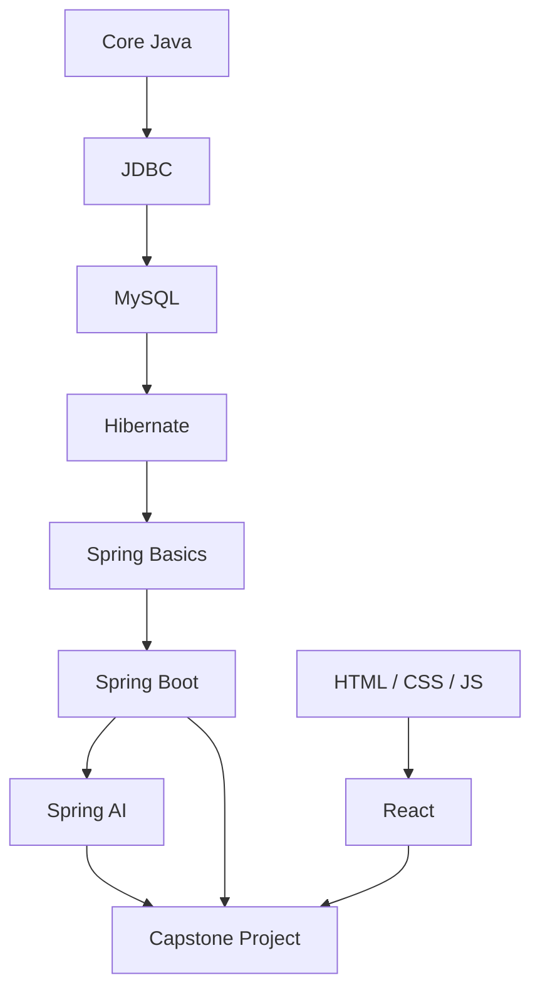

# Full Stack Java Roadmap

| # | Module | Status |
|---|--------|--------|
| 1 | Core Java | :material-progress-clock: Coming soon |
| 2 | JDBC | :material-progress-clock: Coming soon |
| 3 | MySQL | :material-progress-clock: Coming soon |
| 4 | Hibernate | :material-progress-clock: Coming soon |
| 5 | Spring Basics | :material-progress-clock: Coming soon |
| 6 | Spring Boot | :material-progress-clock: Coming soon |
| 7 | Spring AI | :material-progress-clock: Coming soon |
| 8 | HTML, CSS, JavaScript | :material-progress-clock: Coming soon |
| 9 | React | :material-progress-clock: Coming soon |
| 10 | Capstone & Interview Prep | :material-progress-clock: Coming soon |
