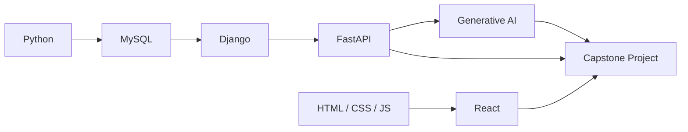

# Full Stack Python Roadmap

| # | Module | Status |
|---|--------|--------|
| 1 | Python | :material-progress-clock: Coming soon |
| 2 | MySQL | :material-progress-clock: Coming soon |
| 3 | Django | :material-progress-clock: Coming soon |
| 4 | FastAPI | :material-progress-clock: Coming soon |
| 5 | Generative AI | :material-progress-clock: Coming soon |
| 6 | HTML, CSS, JavaScript | :material-progress-clock: Coming soon |
| 7 | React | :material-progress-clock: Coming soon |
| 8 | Capstone & Interview Prep | :material-progress-clock: Coming soon |
